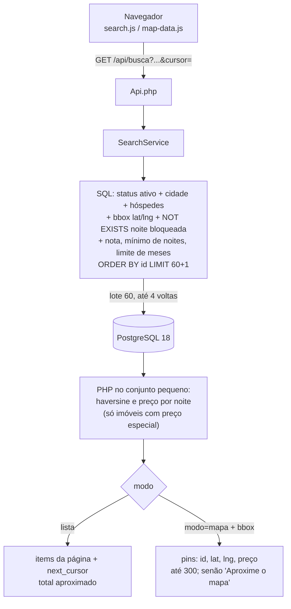

# ADR 001 — Busca filtrada no SQL e paginada

- **Status:** Aceito (sprint 4; #99 e #100 mesclados, develop d2824fc)
- **Depende de:** PR #99 e PR #100, ambos mesclados (develop d2824fc). Sem bloqueios.
- **Base analisada:** `develop` @ `a2e0dc8`
- **Data:** 16/10/2026
- **Evidence:** paths under `/workspace/...` are on the team box (Arquitetura, BD, Segurança evidence folders) and are not in the repo.

**Escopo da busca (16/10, spec `docs/produto/specs/spec-busca-localidade-resolvida.md`, PR #123):** a busca roda só sobre um local resolvido (tabela de lugares ou área do mapa); o fallback de varredura completa do `SearchService` (`HouseRepository::all()` + substring em PHP) é removido.

## Contexto

Hoje a busca pública funciona assim:

1. `SearchService::search` pede **todos** os imóveis ativos: `HouseRepository::all()` (`src/SearchService.php:50`), que roda
   `SELECT * FROM properties WHERE status = 'active' ORDER BY id ASC` (`src/HouseRepository.php:168-170`).
2. Cidade, raio e hóspedes são filtrados **em PHP**, num `foreach` (`src/SearchService.php:57-76`).
3. A disponibilidade busca o calendário de todos os candidatos (`HouseRepository::calendarForProperties`, `src/SearchService.php:78`) e calcula o preço em `stay_quote` (`src/helpers/money.php:47-73`).
4. `/api/busca` devolve **a lista inteira**, sem página (`src/Api.php:287-312`); `public/assets/pages/search.js` e `map-data.js` desenham tudo.

> **Por que isso é um problema?** O custo cresce junto com o catálogo (linear): mais memória, mais CPU e um JSON maior a cada busca, mesmo quando a pessoa só vê 20 cards.

Removed: PostgreSQL only (decisions.md 2026-10-21).

Removed: PostgreSQL only (decisions.md 2026-10-21).

## Opções

| Opção | Prós | Contras |
|---|---|---|
| A. Manter tudo em PHP e só cortar a página no fim | Mudança mínima | O custo de carregar e filtrar tudo continua igual |
| B. **Filtrar no SQL + paginação keyset** | Lê só o necessário; o índice trabalha; a página custa o mesmo em qualquer posição | Mais SQL para manter |
| C. PostGIS / R-tree já | Geo muito preciso e rápido | Dependência e operação novas, cedo demais para o volume atual |
| D. Motor de busca externo (Meilisearch etc.) | Facetas e ranking prontos | Mais um serviço na VPS; YAGNI agora |

## Decisão

**Opção B**, com alvo **PostgreSQL 18** na VPS. PostgreSQL é o único banco (decisions.md 2026-10-21).

### Fluxo novo



### 1. Índices

**Ajustados à ordenação decidida (`id ASC`, seção 3).** A proposta inicial do Bot Banco de Dados tinha `max_guests` no índice. Com a ordem por `id`, o melhor é o índice já entregar as linhas **na ordem do `id`** para a cidade pedida: o banco lê só as primeiras e para (`LIMIT`), sem ordenar.

| Banco | Índice |
|---|---|
| PostgreSQL | `CREATE INDEX idx_prop_city_active ON properties (city, id) INCLUDE (max_guests) WHERE status = 'active';` (parcial: só ativos; `INCLUDE` deixa conferir os hóspedes sem ler a tabela) |
| PostgreSQL (geo) | GiST parcial em `point(lng, lat) WHERE status='active'` (§11) |

Esses índices **nascem no schema** (`database/schema.pgsql.sql`) e nos seeds (seção 6). Os nomes e colunas finais ficam para o Bot Banco de Dados confirmar com o `EXPLAIN` da Cori (§7).

**Escopo (decisão do Gerente, YAGNI):** estes índices e as colunas `rating_sum`/`rating_count` (§4a) **não entram no #100**. Eles entram **no PR da busca SQL**, junto com o código que os usa: DDL em `database/schema.pgsql.sql`, mais o teste de schema no PG (comparando o `pg_get_indexdef` completo, com `INCLUDE` e `WHERE`). Sem consulta que filtre por cidade, o índice só custa escrita: a medição da Cori mostrou o planejador ignorando `idx_prop_city_active` na Q4, que é o `all()` sem filtro.

**Manter `(city, id) INCLUDE (max_guests)`.** Não trocar por só `(city)`: o `id` na chave é o que entrega as linhas na ordem do keyset (§3) e deixa o `LIMIT` parar cedo, sem Sort.

**Sobreposição com os índices atuais (resolver no mesmo PR):**
| Índice atual | Onde | Com os novos | Proposta |
|---|---|---|---|
| `idx_properties_city (city)` | `schema.pgsql.sql:139` (head 772f331) | `idx_prop_city_active` cobre a busca de ativos | **Remover se** nenhuma consulta filtrar por cidade sem `status='active'` (confirmar com `rg "city ="`: vitrine/`searchSource`, painel). Caso contrário, manter. Decisão do Bot BD com EXPLAIN. |
| `idx_properties_status (status)` | `schema.pgsql.sql:141` | Baixa seletividade; coberto pelo índice parcial | **Remover** do schema. |
| `HouseRepository::byCity` | `src/HouseRepository.php:173` | Sem chamador (Bot BD) | Remover ou substituir pela consulta nova. |

**T1b — Índice da capa das fotos (decisão do Gerente, entra neste ADR):**
- **Problema**: a consulta de capas por lote em `src/PhotoRepository.php:100` (`WHERE property_id IN (...) AND status='ready' ORDER BY property_id, is_primary DESC, sort_order, id`) não usa o `idx_photos_cover`.
- **Evidência**: o `idx_photos_cover (property_id, is_primary, sort_order, id)` não cobre o filtro de status nem o DESC (`/workspace/casalivre-db/revisao-modelagem-escala.md` item 6). PG ainda não medido.
- **DDL** (`database/schema.pgsql.sql`): `CREATE INDEX idx_photos_cover_ready ON photos (property_id, is_primary DESC, sort_order, id) WHERE status = 'ready';` e **remover** `idx_photos_cover` (`schema.pgsql.sql:144`). `idx_photos_status` fica até o Bot BD confirmar outro uso (`pg_stat_user_indexes`).
- **Aceite**: `EXPLAIN (ANALYZE, BUFFERS)` da consulta de :100 sem Sort; as consultas de :27 e :85 também passam a usar o índice novo.
- Custo: baixo. Prioridade: média/baixa.

**Teste de schema (PG):** confere, além dos índices da busca, `idx_photos_cover_ready` pelo `pg_get_indexdef` completo (com `DESC` e `WHERE`) e a ausência de `idx_photos_cover` e `idx_properties_status`.

### 2. Geo

Primeiro um **retângulo** barato no índice (`lat BETWEEN ? AND ? AND lng BETWEEN ? AND ?`), depois o haversine em PHP só nas linhas que sobraram. Sem PostGIS nem R-tree por enquanto.

### 3. Paginação keyset (cursor)

**Ordenação padrão (decisão do Gerente): a mesma de hoje, `id ASC`.** Conferido na `develop` atual (origin `develop` @ `4aa8f28`):
- busca geral: `HouseRepository::all()` → `ORDER BY id ASC` (`src/HouseRepository.php:170`);
- vitrine de grupo: `GroupRepository::searchSource` → `ORDER BY id ASC` (`src/GroupRepository.php:197`);
- o `SearchService` não reordena depois (`src/SearchService.php`, sem `usort`), e a API também não (`src/Api.php`).

Como a ordem já é pelo `id`, que é único, ele mesmo é o desempate, e o cursor tem uma coluna só:

```sql
... WHERE p.id > :ultimo_id ORDER BY p.id LIMIT :lote + 1
```

- A API devolve `next_cursor` **opaco** (ex.: base64 do último `id` lido); o cliente não monta cursor.
- Sem `OFFSET` (a UI não usa número de página, seção 5c).
- Sem `COUNT(*)` exato por requisição: total aproximado ("100+") com `LIMIT 101`.
- **Row values:** com cursor de uma coluna, `(col, id) > (?, ?)` não é necessário agora. Se um dia houver outra ordenação por coluna da tabela (ex.: `nightly_price, id`), a forma `(nightly_price, id) > (?, ?)` funciona nativamente no PG.
- **Fora de keyset:** ordenar pelo preço total da estadia ou pela nota calculada em PHP não dá cursor no SQL. Não faz parte desta decisão.
- **Busca por raio** (sem cidade fixa): o filtro usa o índice `(lat, lng)`, que não entrega as linhas em ordem de `id`; o banco ordena o recorte do retângulo antes do `LIMIT`. O recorte é pequeno (um retângulo de no máximo 25 km), mas o custo cresce com a densidade da área. Medir no cenário do Teste.

> **Por que manter `id`?** É a ordem que os usuários já veem hoje, então nada muda na tela; é única (o cursor fica trivial) e é a mais barata de indexar. Mudar a ordenação seria decisão de produto, não de desempenho.

### 4. Disponibilidade

**Ajuste ao schema real:** `calendar_days` (`database/schema.pgsql.sql`) **não tem coluna `status`**. As colunas são `blocked` (0/1), `price`, `min_nights` e `origin` (`''`, `'sync'`, `'reserva'`). A tabela é **esparsa**: só guarda os dias com alguma exceção (bloqueio, preço ou mínimo próprios). Um dia sem linha está **disponível** com o preço base (`stay_quote`, `src/helpers/money.php:60-64`). A cláusula fica assim:

```sql
AND NOT EXISTS (
  SELECT 1 FROM calendar_days c
  WHERE c.property_id = p.id
    AND c.day >= ?   -- checkin (inclusivo)
    AND c.day <  ?   -- checkout (exclusivo: a noite do checkout não conta)
    AND c.blocked = 1
)
```

O intervalo é semiaberto e não usa função em `c.day`, então a PK `(property_id, day)` atende. Em dev, `day` é texto ISO `YYYY-MM-DD`, que compara certo como string; no PG é `DATE`.

O `NOT EXISTS` **não substitui** tudo o que o `stay_quote` faz hoje. Continuam em PHP, sobre a página:
- o `min_nights` do dia de check-in (`money.php:53-56`);
- o horizonte `max_calendar_day` (`money.php:58-61`);
- o preço por noite, que muda o filtro `preco_min`/`preco_max` (`SearchService.php:88-93`).

Na seção 4a estão decididos o mínimo de noites e o limite de meses (vão para o SQL, exatos), o preço por noite (fica no PHP, com pré-filtro exato) e a nota mínima (vai para o SQL, com coluna desnormalizada).

### 4a. Onde cada filtro roda: abordagem híbrida (decisão do ponto 1)

**Regra:** nenhum filtro muda de significado. Vai para o SQL só o que o banco consegue responder **exatamente** como o PHP responde hoje. O resto fica no laço da seção 5a.

> **Por quê?** Se o SQL só "aproximasse", a busca nova mostraria imóveis diferentes da antiga (o critério de aceite 8 quebraria) e o dono não entenderia por que sumiu. Tirando do laço o que o banco resolve exato, a página costuma encher na **primeira** consulta, e o laço vira exceção.

| Filtro | Regra hoje no código | Onde fica | Como, de forma exata |
|---|---|---|---|
| (a) `score_min` | Média simples de **todas** as avaliações (`AVG(score)`, sem filtro de estado), arredondada para 1 casa em PHP (`round(..., 1)`, `src/HouseRepository.php:492-517`); descarta se não há avaliação ou se `média_arredondada < score_min` (`src/SearchService.php:109`) | **SQL** | Colunas novas em `properties` (entram no PR da busca, não no #100): `rating_sum INTEGER NOT NULL DEFAULT 0` e `rating_count INTEGER NOT NULL DEFAULT 0` (inteiros, sem média em ponto flutuante). Com `t = ceil(10 × score_min)` calculado em PHP (com `round(10×s, 6)` antes do `ceil`, contra erro de float): `rating_count > 0 AND 20*rating_sum + rating_count >= 2*t*rating_count`. Isso equivale exatamente a `round(média,1) >= score_min` (arredondamento meio-para-cima, como o `round` do PHP para notas positivas). |
| (b1) mínimo de noites | `minimo = min_nights do calendar_days no dia do check-in, se > 0; senão properties.min_nights`; recusa se `noites < minimo` (`src/helpers/money.php:53-56`) | **SQL** | `:noites >= COALESCE((SELECT CASE WHEN c.min_nights > 0 THEN c.min_nights END FROM calendar_days c WHERE c.property_id = p.id AND c.day = :checkin), p.min_nights)`, usando a PK. O `CASE` reproduz o `> 0` (um `NULLIF(...,0)` deixaria passar valor negativo). |
| (b2) limite de meses | Recusa se alguma noite passa de `hoje + meses` (`money.php:58-61`); `meses = min(calendar_months do imóvel, ou 6 se < 1; setting calendar_months)` (`src/helpers/dates.php:115-134`) | **SQL**, com valor calculado em PHP | Somar meses no SQL não é portável: o PHP faz 31/01 + 1 mês = 03/03, o PG faz 28/02. Então o PHP calcula, com o mesmo `DateTimeImmutable::modify`, o **menor** `m_min` em que `hoje + m_min meses >= última noite`. Se `m_min > teto`, a resposta é vazia sem consultar. Senão: `(CASE WHEN p.calendar_months < 1 THEN 6 ELSE p.calendar_months END) >= :m_min`. Exato, e "hoje" continua sendo a data do PHP. |
| (c) preço por noite com datas (`preco_min`/`preco_max`) | `nightly = round(total/noites)`, com o preço de cada noite vindo de `calendar_days.price` ou de `properties.nightly_price` (`money.php:60-71`) | **PHP** (laço 5a) + pré-filtro SQL exato | Imóvel **sem** nenhum `calendar_days.price` no intervalo tem `nightly = nightly_price` exatamente. Pré-filtro: `(EXISTS (SELECT 1 FROM calendar_days c WHERE c.property_id = p.id AND c.day >= :checkin AND c.day < :checkout AND c.price IS NOT NULL) OR p.nightly_price BETWEEN :min AND :max)`. Só os imóveis com preço especial no período vão para o PHP. Sem datas, o filtro é 100% SQL (`nightly = nightly_price`). |

**Manutenção da nota (a):**
- `HouseRepository::addReview` (`src/HouseRepository.php:486-490`) passa a fazer, **na mesma transação** do `INSERT INTO reviews`: `UPDATE properties SET rating_sum = rating_sum + :score, rating_count = rating_count + 1 WHERE id = :id`.
- As colunas **nascem no schema**; o seed as preenche (ver abaixo).
- Hoje não há `UPDATE`/`DELETE` de `reviews` no código (só o `ON DELETE CASCADE` junto com o imóvel). `scripts/seed_massive.php:53` insere avaliações **direto**, sem o `addReview`: o seed precisa recalcular as colunas no fim (`UPDATE properties SET rating_sum = COALESCE((SELECT SUM(score) FROM reviews r WHERE r.property_id = properties.id), 0), rating_count = (SELECT COUNT(*) FROM reviews r WHERE r.property_id = properties.id)`).
- Teste de consistência: `rating_sum`/`rating_count` batem com `SUM`/`COUNT` de `reviews` depois do seed e depois de N avaliações.

**Custo:** duas colunas inteiras (um `SCHEMA_VERSION` a mais) e uma escrita extra (o `UPDATE`) por avaliação. As avaliações são raras e têm rate limit (10/h por IP), então o custo é desprezível perto do ganho na busca.

**Nota:** o `calendar_months` tem de estar em `database/schema.pgsql.sql` (sem `ALTER TABLE` em código de migração; decisions.md 2026-10-21).

### 5. Mapa: consulta leve própria

O mapa não reaproveita a lista. Ele pede **só a área visível**:

`GET /api/busca?modo=mapa&bbox=lat_min,lng_min,lat_max,lng_max&checkin=&checkout=&hospedes=`

- Resposta: `{ "pins": [ {"id","lat","lng","preco"} ], "limite": 300, "acima_do_limite": false }`. A coordenada é a pública (`public_coord`), nunca a exata.
- **Limite: 300 pins.** O SQL usa `LIMIT 301`. Se vierem 301, a resposta tem `"pins": []` e `"acima_do_limite": true`, e a UI mostra "Aproxime o mapa".
- Os clusters são montados no navegador (MapLibre, GeoJSON), sobre no máximo 300 pontos.
- Tocar no pin abre o card pelo `id`, com `GET /api/imoveis/<h>` (rota que já existe).
- Usa o mesmo filtro SQL da lista (ativo, hóspedes, `NOT EXISTS` de noite bloqueada) + bbox no índice `(lat, lng)`. Sem facetas e sem cursor.

### 5a. Lista: completar a página (laço)

Com a seção 4a, só **um** filtro fica em PHP: o preço por noite com datas, e só para imóveis com preço especial no período. Esses imóveis podem cair fora do filtro depois do SQL, então a página pode vir com menos de 20. O `SearchService` completa assim (valores mantidos):

| Parâmetro | Valor |
|---|---|
| Itens por página (`por_pagina`) | 20 (`results_per_page`) |
| Lote por consulta SQL | 60 (3 × página) |
| Máximo de consultas por requisição | 4 |
| Pior caso lido do banco | 4 × 60 = **240 linhas**, mais 4 consultas de calendário/notas/fotos só sobre essas linhas |

Se depois de 4 consultas ainda não houver 20, a API devolve **o que encontrou** (pode ser 0) e o `next_cursor` aponta para a última linha lida, nunca para o último item mostrado. O botão continua dali, e nenhum imóvel é pulado nem repetido. Assim o custo por requisição tem teto fixo, por mais restritivos que sejam os filtros.

**Métrica:** registrar `iteracoes` (1 a 4) e `linhas_lidas` por requisição de `/api/busca` (campo no `RequestLog` ou contador no log de desempenho, sem dado pessoal). Esperado: quase sempre 1. Se ficar alto, o pré-filtro de preço não está funcionando ou o lote é pequeno.

### 5b. Contrato JSON da lista

`GET /api/busca?...&cursor=<opaco>` →

```json
{
  "items": [ { "id": "...", "title": "...", "city": "...", "nightly_price": 0, "photo": "...", "score": null, "quote": null, "distance_km": null } ],
  "next_cursor": "opaco ou null",
  "total_aprox": "100+",
  "facets": ["piscina", "churrasqueira"],
  "filters": { }
}
```

- `total_aprox`: `"100+"` quando passa de 100 (contagem limitada: `SELECT 1 ... LIMIT 101`), o número exato abaixo disso, ou `null`.
- `facets` (decisão do Gerente): **sem contagem**. É só a lista das comodidades que existem para filtrar; a UI não mostra número. Assim não há agregação extra por requisição.
- O `lat`/`lng` sai da lista: o mapa tem consulta própria.

### 5c. Decisão do Bot UI (fecha a pendência de scroll × página)

- Botão **"Mostrar mais imóveis"** no desktop e no celular. Não há número de página, então **não entra `OFFSET`**.
- No celular, a lista carrega sozinha **uma vez** perto do fim; depois, só pelo botão. Isso evita rolagem infinita sem fim e mantém o rodapé alcançável.
- O cursor e a posição de rolagem ficam no estado e na URL (`history.replaceState`), para que o "voltar" do navegador volte ao mesmo ponto.
- Mudar filtro, datas ou área do mapa **zera o cursor**.
- Sem total exato: "Mais de 100" ou nada.
- Facetas sem contagem (decisão do Gerente).
- Mapa: consulta leve pela área visível, limite e clusters, "Aproxime o mapa" acima do limite, pin abre o card pelo id.

### 6. Schema e seeds, sem migração de dados (decisions.md 2026-10-21)

**Decisão:** não há migração de dados. O banco é criado do zero (schema + seeds). Os índices da seção 1 e de §11 e as colunas `rating_sum`/`rating_count` entram **direto** em `database/schema.pgsql.sql`, e os seeds são atualizados. Não há código de migração, conversão de dados legados, backfill nem passo de migração no deploy. `SCHEMA_VERSION` continua subindo. Migração de dados só volta por decisão explícita do Rafael.

**Consequência para o código atual (confirmada pelo Gerente, 2026-10-21):** o `migrate()` por requisição e a conversão `money_unit` do #99 (dividir preços por 100) **saem** e não são versionados.

**Substituto: checagem barata da versão do schema.**
- A app compara `Db::SCHEMA_VERSION` com a leitura de uma linha só em `schema_meta(version)`, com cache por worker do FPM [E].
- Se o banco estiver atrás, registra no log uma vez e responde `/api` com **503 em JSON** (backlog L202).
- **Nunca há `ALTER` em tempo de execução.**
- **Mudar para um schema novo é um passo manual:** recriar o schema (`database/schema.pgsql.sql`) e carregar os seeds.
- **Custo:** cerca de uma leitura indexada de uma linha por requisição, ou nenhuma com o cache por worker [E].

### 7. Baseline medida e roteiro de medição (Cori, PG 18)

**Baseline** (Cori, PG 18, `seed_massive`, 10 concorrentes; medida no #99 no commit **05ed153**, não no a920748). **Nota:** o 05ed153 não existe no remoto; o #99 foi mesclado e a `develop` atual é **2460ed0**. Logs em `~/cori-deploy/m/`, na máquina do Rafael.
| Métrica | Antes do #99 | Depois do #99 |
|---|---|---|
| p50 | 1.601 ms | ~568-684 ms |
| p95 | 5.794 ms | ~680-2.423 ms |
| Consultas por requisição | 1.523 | 4 |
| Esperas de lock | 190 | 0 |

- **p95 ainda longe da meta de 300 ms.** O próximo gargalo é a Q4, `SELECT *` do `HouseRepository::all()` (`src/HouseRepository.php:168-170`, chamado por `SearchService.php:50` e `CalendarSync.php:67`), com **65-118 ms**. O custo é transferir todas as linhas inteiras, não falta de índice; por isso a Q4 ignora `idx_prop_city_active`. **Este ADR ataca exatamente o `all()`.**
- **Q5 (bbox lat/lng): 3,5 → 0,57 ms** com o índice, mas a Q5 foi **escrita à mão** e **não existe no app**. O ganho só chega ao usuário quando o modo mapa (§5) for implementado.
- `translations` aparecia com ~75 mil chamadas na develop pré-#99. Ver diagnóstico, §3 (não é escopo deste ADR).

**Roteiro para a Cori depois do PR da busca:**
1. `VACUUM (ANALYZE)` em properties, calendar_days e reviews antes de medir.
2. `EXPLAIN (ANALYZE, BUFFERS)` da consulta nova em 3 cidades: a **maior**, uma **média** e uma com **1 a 5 imóveis** (anotar a distribuição de imóveis por cidade).
3. Para cada uma: **primeira página** e **uma página adiante pelo cursor**; **com e sem** filtro de hóspedes.
4. Anotar: tipo de scan, `Heap Fetches`, `Rows Removed by Filter`, buffers (hit/read) e a **mediana de 3 execuções**.
5. Custo de escrita: tempo de `UPDATE properties` (preço/status) **com e sem** `idx_prop_city_active`.
6. Repetir a carga da baseline (10 concorrentes) e comparar p50/p95 e consultas por requisição.
- **Esperado:** Index Only Scan sem Sort na cidade pequena e na média com LIMIT. Seq Scan é aceitável na cidade grande quando a fração é alta e sem LIMIT efetivo. Se o planejador ignorar o índice na cidade pequena, o Bot BD reavalia.

## Consequências

- **Boas:** custo por busca proporcional à página, e não ao catálogo; o JSON fica pequeno; o índice passa a decidir o plano.
- **Ruins / custos:** o contrato JSON muda (`items` + `next_cursor` + `total_aprox`), então `search.js` e `map-data.js` precisam mudar. As facetas perdem a contagem (decisão do Gerente). Há um `SCHEMA_VERSION` novo.
- **Vitrine de grupo:** `GroupRepository::searchSource` precisa entrar no mesmo construtor de SQL, para não divergir.

## Critérios de aceite

1. p95 de `/api/busca` **< 300 ms** no php-fpm da VPS (cidade + datas, catálogo de teste definido pelo Bot Teste, 100 buscas simultâneas sem 500).
2. Primeira página **< 50 KB com gzip** (≤ 20 itens).
3. Mapa: nunca mais de 300 pins por resposta; acima disso, `acima_do_limite: true` e lista vazia. p95 de `modo=mapa` < 300 ms. Payload do mapa medido com 300 pins; o limite em KB fica para o Teste definir depois da primeira medição.
4. Pior caso da lista: no máximo 4 consultas e 240 linhas lidas por requisição (conferir no log de consultas ou com contador em teste).
5. Métrica `iteracoes` registrada em toda `/api/busca`; no cenário de carga do Teste, **p95 de `iteracoes` = 1**. Só filtros de preço com datas sobre imóveis com preço especial podem passar de 1.
6. Filtros exatos: para cada combinação de `score_min`, mínimo de noites, limite de meses e preço do conjunto de caracterização, a busca nova devolve exatamente o mesmo conjunto que a antiga. Incluir casos de borda: média x,x5; `min_nights` 0 ou NULL no check-in; check-in em 31/01 com limite de 1 mês; preço especial só numa noite.
7. `rating_sum`/`rating_count` iguais a `SUM`/`COUNT` de `reviews` depois do seed e de novas avaliações.
8. "Mostrar mais" percorre o resultado inteiro sem repetir nem pular imóvel (teste comparando com a busca antiga sem paginação).
9. Banco novo (PG) nasce com os índices da seção 1 e com `rating_sum`/`rating_count` (teste de schema).
10. `EXPLAIN (ANALYZE, BUFFERS)` (PG 18) mostra o **índice novo** (`idx_prop_place_active`, §11) sem passo de ordenação extra na busca por cidade e o `NOT EXISTS` pela PK de `calendar_days`, sem varredura total de `properties`.
11. Mesmos imóveis visíveis que hoje para os mesmos filtros (teste de caracterização comparando busca antiga × nova).

## Pendências

- [x] ~~Bloqueante: PR #99 (`migrate()` fora da requisição, `money_unit`)~~: mesclado. O código de migração restante sai pela seção 6.

**Não bloqueantes** (são critérios de aceite ou de implementação, não impedem o início):

- [ ] `EXPLAIN (ANALYZE, BUFFERS)` real no PG 18: **Cori** (medição no PG 18). Benches e EXPLAIN no PG 18 do ambiente de dev estão em §11 (`/workspace/adr/bench-adr001-places/`); falta a medição no seed real, com o roteiro em `/workspace/casalivre-db/diagnostico.md`.
- [x] ~~Medir antes/depois de tirar o `migrate()` da requisição~~: feito pela Cori (§7, baseline).
- [ ] Medição pós-PR da busca pelo roteiro do §7: **Cori**; confirmação do índice e da sobreposição: **Bot Banco de Dados**.
- [x] ~~UI: scroll infinito ou número de página~~ — decidido pelo Bot UI (seção 5c): botão "Mostrar mais imóveis", sem `OFFSET`.
- [ ] Contrato JSON novo afeta `public/assets/pages/search.js` e `map-data.js`: **Programador**, via Gerente.
- [x] ~~Semântica de `preco_min`/`preco_max` com datas e de `score_min`~~: decidida na seção 4a (híbrido, sem mudar significado).
- [ ] Implementar a seção 6: índices e colunas em `database/schema.pgsql.sql` e nos seeds: **Programador**, via Gerente.

## 8. Ajustes de 16/10/2026 (avaliação do Produto; parte de banco com o Bot BD)
1. **Vitrine genérica (T3/T6):** o construtor SQL recebe uma "vitrine", um objeto com um filtro extra opcional. Hoje a vitrine é o grupo (`GroupRepository::searchSource`); depois será o canal da P2a. O custo é baixo, porque o construtor único já estava previsto.
2. **Disponibilidade numa função única** (`Availability::sqlNotBlocked()`), usada pela lista, pelo mapa e pela vitrine. As reservas e as esperas de pagamento viram linhas em `calendar_days`.
   - Agora (código, no PR deste ADR):
     - Corrigir o `blockDay` (`HouseRepository.php:340`), que sobrescreve `origin` sem condição. Passa a ser `ON CONFLICT DO UPDATE ... WHERE calendar_days.origin <> 'reserva'`, e toda limpeza do sync filtra `origin='sync'`.
     - Prioridade: reserva > sync > manual.
     - É um risco real hoje, porque o sync pode liberar um dia reservado.
   - Na spec 21 (ou 22, junto com a tabela de reservas):
     - `CHECK (origin IN ('manual','sync','reserva'))`, com `'manual'` no lugar de `''`.
     - `hold_until timestamptz NULL` e `booking_id NULL`.
     - Índice parcial em `(hold_until) WHERE hold_until IS NOT NULL`.
     - A FK entra quando a tabela de reservas existir.
   - Reserva: upsert de todas as noites numa transação, com `ON CONFLICT DO UPDATE SET blocked=1, origin='reserva' ... WHERE calendar_days.blocked=0`. Se o rowCount for menor que o número de noites, ROLLBACK. A PK `(property_id, day)` impede a dupla reserva.
   - Busca: `NOT EXISTS (... blocked=1 AND (hold_until IS NULL OR hold_until > now()))`. A PK continua atendendo.
   - Custo médio.
3. **Preço com datas (T5):** com check-in e check-out, `preco_total` (diárias + limpeza + taxa, calculado pelo `stay_quote` que já existe) vem como valor principal e `preco_noite` como secundário. O filtro `preco_min`/`preco_max` continua por noite. Sem datas, só `preco_noite`. Custo baixo: o PHP já calcula o total para a página. Não muda o laço nem o SQL.
4. **PG 18 do contêiner é a referência:** índices, EXPLAIN e medição só no PG; o §7 mede no contêiner. Removed: PostgreSQL only (decisions.md 2026-10-21).

**Ordem aceita:** correção de XSS, depois o ambiente bwrap (P0, no início da S4), depois o ADR 001 (SCHEMA 20), depois a spec de schema (21, com o desenho de fila com Valkey e, se for barato, o DDL de reserva). O ambiente vem antes para medir uma vez só. Custo zero.

## 9. Portas para a P4/P5 (spec-07; parecer do Bot BD, 16/10/2026)
- **Cursor (T4) opaco e versionado já:** `{v, sort, last_key, id, checkin, checkout, hospedes}`. O servidor rejeita (400) um cursor cujos filtros mudaram. `last_key` é inteiro em reais.
- **Construtor (T3):** recebe a chave de ordenação como parâmetro. Hoje o único valor é `id`.
- **Ordenar ou filtrar por total, no futuro:** CTE com o total calculado no SQL: `nightly_price × noites + SUM(c.price - nightly_price)` sobre as exceções com price NOT NULL em [checkin, checkout), mais limpeza e taxa, com LATERAL pela PK. Keyset `(total, id)`. O total não é indexável, então o banco calcula para todos os candidatos do filtro. Exigir cidade ou bbox pequeno para ordenar por total. Medir no PG 18 na maior cidade do seed antes de liberar. Índice `INCLUDE (price, blocked, min_nights)` só com medição.
- `min_nights` continua no SQL (LEFT JOIN do dia de check-in pela PK).
- Um preço que muda entre páginas causa pulo ou repetição pontual: é aceitável.

## 10. Decisões do Produto (16/10/2026)
- **Escala da nota: inteiro de 1 a 5**, para a nota geral e para cada critério. A nota geral fica em `reviews.score`. No **SCHEMA 20**, o CHECK de `reviews.score` passa de `BETWEEN 1 AND 10` para `BETWEEN 1 AND 5` (schema.pgsql.sql:133). Só schema e seed, sem conversão de dados. `rating_sum`/`rating_count` não mudam. A média exibida e o `score_min` usam 1 casa decimal. O seed precisa gerar notas de 1 a 5.
- **Aprovados para este PR:** o cursor opaco e versionado e o construtor recebendo a ordenação (§9).
- **Ordenação por total (futuro):** só fica disponível com a cidade fixada ou com o mapa num zoom suficiente (bbox pequeno). Isso está alinhado com a ressalva de custo do §9.

## 11. Scope addition: search only on a resolved place (2026-10-16, English; updated 2026-10-21)

**2026-10-21 (decisions.md on develop, PR #139):** CasaLivre is **PostgreSQL only** (SQLite dropped) and there is **no data migration**: the DB is recreated from scratch with seeds; schema changes update `database/schema.pgsql.sql` and the seeds only (`Db::SCHEMA_VERSION` still bumps). No SQLite variant, parity check against SQLite, backfill or legacy-data conversion is part of this ADR.

Source: `/workspace/produto-draft/proposta-busca-localidade.md` (Produto, after the Negocios review). Measurements: own dev env (Void musl, PG 18.6, shared_buffers 128MB, 8 vCPU box, pgbench `-c 4 -j 4 -T 8`, DB time only, no HTTP/PHP). Scripts and raw output: `/workspace/adr/bench-adr001-places/`. Synthetic data: 62,406 places (5,572 real cities from `database/cities.json`, 55,720 neighborhoods, 1,114 POIs); 100,000 properties (90% active, 30% concentrated in 20 cities, ~4.5k active in the densest); 1.8M sparse `calendar_days` rows. Not production numbers.

### Decision
- Search always runs on a resolved place: `place_id` (city / neighborhood / POI / region) or a map bbox. The free-text path in `SearchService::search` (`src/SearchService.php:66-69`, substring scan over `HouseRepository::all()`) is **removed**; `HouseRepository::all()` is no longer called by search.
- Unresolved `localidade=` text (old shared URLs, submit without picking) is resolved once server-side with the autocomplete query (`LIMIT 9`): 1 hit → redirect/canonicalize to `local_id`; 2–8 → "Did you mean"; 0 → "We couldn't find that place". No listing query runs in the last two cases.

### Schema (SCHEMA 20, `database/schema.pgsql.sql` + seeds)
```sql
CREATE TABLE places (
  id int GENERATED BY DEFAULT AS IDENTITY PRIMARY KEY,
  type text NOT NULL CHECK (type IN ('region','city','neighborhood','poi')),
  parent_id int REFERENCES places(id) ON DELETE RESTRICT,
  name text NOT NULL, name_fold text NOT NULL,   -- fold() done in PHP (no unaccent/pg_trgm in the PG build)
  label text NOT NULL, uf char(2) NOT NULL,
  lat double precision NOT NULL, lng double precision NOT NULL,
  bbox_s double precision, bbox_w double precision, bbox_n double precision, bbox_e double precision, -- regions/POIs
  popularity int NOT NULL DEFAULT 0);
CREATE INDEX idx_places_name_fold ON places (name_fold);        -- PG: needs C collation (dev DB is C) or text_pattern_ops
-- properties (schema + seed, no data conversion): city/uf replaced by city_place_id int NOT NULL REFERENCES places(id), neighborhood_place_id int NULL REFERENCES places(id)
CREATE INDEX idx_prop_place_active ON properties (city_place_id, id) INCLUDE (max_guests) WHERE status = 'active';  -- replaces idx_prop_city_active
CREATE INDEX idx_prop_geo_active ON properties USING gist (point(lng, lat)) WHERE status = 'active';
```
`cities` is replaced by `places` (type `city`), loaded by the seed from `database/cities.json`; `CityRepository::match`/`suggest` become SQL on `places`.

### Findings (problem / evidence / proposal / cost / priority)
| # | Problem | Evidence | Proposal | Cost | Priority |
|---|---|---|---|---|---|
| P1 | Free-text fallback loads all listings | `src/SearchService.php:50,66-69` | Remove; resolve text to a place first (above) | Low (part of the ADR 001 rewrite) | High |
| P2 | Autocomplete must be accent/case-insensitive and match any word start (§11.2), but the PG 18 build has **no contrib** (`unaccent`, `pg_trgm`, `btree_gist` unavailable) | `pg_available_extensions` = 0 rows | Store `name_fold` computed by PHP `fold()`; prefix `LIKE 'x%'` on a btree. Works because DB collation is `C`; if prod is not `C`, use `text_pattern_ops`. Contains-match (trigram) is out of scope | Low | High |
| P3 | Autocomplete p95 target < 50 ms | Measured p95: `sa` 0.41 ms, `sao` 0.38, `rio` 0.20, `geri` 0.15; worst case `bair` (55k synthetic names share the prefix) 13.5 ms | Btree on `name_fold`; `ORDER BY popularity DESC, id LIMIT 8`; from 2 chars is fine. Optional `(name_fold, popularity)` not needed now | Low | — (target met) |
| P4 | City search should use the place id, not a text compare | Plan: Index Only Scan on `idx_prop_place_active`, 61 rows, 0 heap fetches, 0.06 ms (city with 4.5k active) | `properties.city_place_id` FK + partial index above; neighborhood/POI searches use center + radius (geo index) or `neighborhood_place_id` | Medium (seed/forms write the FK) | High |
| P5 | Map bbox ("Search this area") now applies to every search | GiST partial on `point(lng,lat)`, id-sorted page, p95: 0.5–1.5 ms up to 260 candidates, 4.1 ms at 1.1k, 11–16 ms at 4.3–5.9k | GiST (core PG, no extension). Radius = bbox prefilter + haversine in PHP (unchanged) | Low | High |
| P6 | Sort by total price is not indexable; cost grows with candidates | see §11.1 | Guard by candidate count (§11.1) | Low | High (UI needs it) |
| P7 | Demand log (unresolved text, zero-result places) adds a write per search | Not measured | See §11.3 (approved by Segurança with 7 conditions and by Jurídico) | Low [E] | Medium |
| P8 | Old `localidade=` URLs | spec step 5 | URL redirect only: resolve + 301 to the `local_id` URL (no data migration involved); the cursor (§9) carries `local_id` instead of text | Low | Medium |

### 11.1 Threshold for sorting by total price (performance guard only)
Total = `nightly_price × nights + Σ(exception price − nightly_price) + cleaning_fee`, 7 nights, `NOT EXISTS` blocked night, `ORDER BY total, id LIMIT 61`. p95 (ms), DB only:

| Area (km²) | Dense: candidates | total p95 | id-sort p95 | Sparse: candidates | total p95 |
|---|---|---|---|---|---|
| 4 | 39 | 1.2 | 0.7 | 1 | 0.9 |
| 28 | 260 | 2.2 | 1.5 | 2 | 0.9 |
| 111 | 1,077 | 5.2 | 4.1 | 5 | 1.0 |
| 443 | 4,331 | 16.1 | 11.5 | 32 | 1.2 |
| 1,773 | 4,360 | 17.4 | 10.9 | 97 | 1.4 |
| 11,083 | 4,702 | 18.0 | 12.2 | 385 | 2.5 |
| 44,333 | 5,870 | 21.9 | 16.0 | 1,436 | 6.6 |
| (d=3°) | 13,411 | 47.1 | — | | |
| (d=8°) | 28,415 | 136.8 | — | | |
| (d=50°) | 85,947 | 338.6 | — | | |

Cost is linear in **candidates** (~3.5 µs each), not in area: 443 km² gave 4.3k candidates in the dense city and 32 in the sparse one. So:
- **Rule:** total-price sort is allowed when the filtered candidate set is **≤ 5,000** (measured p95 ≤ ~22 ms; 13k crosses ~47 ms). Server checks with a capped count (`SELECT 1 … LIMIT 5001`, same WHERE as the page, ~id-sort cost).
- ~~**UI hint (not the guard):** offer the sort from bbox ≤ 500 km² (zoom ≥ 13 desktop, ≥ 12 mobile).~~ Dropped in §12.7a: the server decides through G-1a.
- **Above the threshold:** superseded by §12 G-1a (cap 2,000; fallback is the relevance order with `sort_effective`/`sort_fallback_from`, see §12.7a). Original text: the sort is disabled and the server returns the default `id` order with `sort_unavailable: "zoom_in"`.
- Re-measure with the Bot Teste on the real seed and concurrency before raising 5,000.

### 11.2 Place search keys (Produto requirement on change 1, accepted 2026-10-16)
**Problem:** a prefix on the full name misses "forte" → Praia do Forte and "cabo" → Arraial do Cabo.
**Design:**
```sql
CREATE TABLE place_search_keys (
  place_id int NOT NULL REFERENCES places(id) ON DELETE CASCADE,
  key text COLLATE "C" NOT NULL,                       -- folded by PHP fold(), lowercase ASCII, single spaces
  kind text NOT NULL CHECK (kind IN ('name','alias')),
  popularity int NOT NULL,                              -- denormalized from places, refreshed with it
  PRIMARY KEY (key, place_id) INCLUDE (popularity));   -- serves the prefix scan as an index-only scan (§11.4)
```
- **Keys are word suffixes, not single words:** one key per word start, running to the end of the name: "praia do forte" → `praia do forte`, `forte`. With suffixes, a multi-word prefix like "arraial do c" or "praia do f" still matches; single-word keys can't do that without an AND across rows.
- **Stopwords** (`de, da, do, das, dos, e`) never **start** a key, but stay **inside** keys. So "do forte" is not a key, and typing "praia do f" still matches the full-name key.
- **Aliases** (`kind='alias'`) are admin-managed, seeded from place names, and cover known misspellings and nicknames. They are the only typo handling in P0: **no typo tolerance** (no `pg_trgm` in the PG build). Typo tolerance stays in the backlog.
- Keys are generated in PHP (`fold()`) when a place is written or seeded. The bench used SQL only to load data.
- **Query:** escaped prefix `LIKE` on the `C`-collated key (PHP escapes `\`, `%`, `_` in the input, §11.4):
```sql
SELECT p.id, p.label, p.type FROM (
  SELECT place_id, MAX(popularity) AS pop FROM place_search_keys
  WHERE key LIKE :q_escaped || '%' ESCAPE '\'
  GROUP BY place_id ORDER BY pop DESC, place_id LIMIT 9) k
JOIN places p ON p.id = k.place_id ORDER BY k.pop DESC, p.id;
```
- **Results (UI spec in PR #127 @a5187d6):** minimum 2 chars. Fetch 9 and show at most 8. With 9 or more matches, show the top 8 plus "Keep typing to narrow it down". Server-side free-text resolution: 1 match → use it; 2–8 → "Did you mean"; 9 or more → ambiguous, show the same list, **never auto-pick**; 0 → "We couldn't find that place".
- **Size (bench):** 213,039 keys for 62,408 places (~3.4 per place, inflated by the synthetic "Bairro N, City" names), 25 MB total, 12 MB PK. `places` is 14 MB.
- **Acceptance (bench data, real names):** "forte" → #1 Praia do Forte (Mata de São João, BA); "geriba" → #1 Praia de Geribá (Armação dos Búzios, RJ); "arraial" → Arraial do Cabo, RJ at #3; "cabo" → Arraial do Cabo, RJ at #3 (after Cabo Frio and Cabo de Santo Agostinho). The order follows synthetic popularity. All three are in the top 8.
- **p95 (pgbench -c 4, DB only), full-name index before → keys after:** sao 0.39 → 2.96 ms; rio 0.20 → 1.41; geri 0.16 → 0.42; forte 0.16 → 0.41; praia 0.59 → 1.15; worst case "ba" (57.8k matching keys) 12.7 → 27.1; "bair" (55.7k synthetic neighborhoods) 15.1 → 28.6. "b" is 27.4 but is below the 2-char minimum. All under the 50 ms target. The worst cases cost more because `GROUP BY` reads every matching key; real names won't share prefixes like the synthetic "Bairro N" names do [E].
- Cost: low. Priority: high (acceptance criteria).

### 11.3 Demand log (P7): Segurança conditions 1–7 and Jurídico acceptance
Sources: `/workspace/casalivre-seguranca-evidence/adr001-demand-log/verdict.md` (approved with conditions), `/workspace/casalivre/juridico/adr001-p7-demand-log-legal.md` (approved, conditional on 1–7).
1. **Redact before HINCRBY:** fold, trim, cap at 64 chars. Drop the term entirely if it matches an email, URL, phone or CPF/CNPJ, or has ≥ 6 digits in total.
2. **k-threshold at flush:** persist only terms with a daily count ≥ 5; discard the rest.
3. **No hashing:** store redacted plaintext plus the threshold (hashing is dictionary-reversible and kills the BI use).
4. **No user id, IP, session, user location, or time finer than a day.** Zero-result entries store `place_id` only.
5. **Retention:** Valkey key `cl:demand:{YYYY-MM-DD}` with `EXPIRE 172800`. PG rows kept 12 months, then deleted or rolled up to a monthly top-N.
6. **Same redaction in `activity_log` search params.** nginx 14-day access-log retention is accepted; never put the query string in any longer-lived log. **Required changes (backlog, PR #139):**
   - `src/SearchService.php:33` writes the raw `$filters` (including `localidade`) to `activity_log` (`activity(ActivityLog::SEARCH, $filters + …)`). Log `local_id` and the other structured filters; `localidade` is either dropped or passed through the same masking as the demand log (condition 1: fold, trim, 64 chars, drop if it looks like email/URL/phone/CPF/CNPJ or has ≥ 6 digits).
   - `src/RequestLog.php:165-166` `QUERY_VALUE_ALLOWLIST` keeps the values of `q` and `localidade`. Remove both from the allowlist (they are then logged as `null`) or route them through the same demand-log masking instead of the generic `mask()`.
   - Test: a search with `localidade=fulano@x.com` or 6+ digits leaves neither value in `activity_log` nor in the request log.
7. **PG table readable only by the BI/admin role**, not by the app web role. INSERT/UPDATE by the flush worker only.

**Design rule (Jurídico, art. 12):** `search_demand_daily (day date, kind text CHECK IN ('unresolved','zero_result'), term text NULL, place_id int NULL, count int, PRIMARY KEY …)` has **no user, session or IP columns and no FK to any table that has them**. The only reference allowed is `place_id` → `places`, which has no personal data. Joining it with identifying data is forbidden: art. 12 §2 would make it personal data again. Legal basis for the transient phase (raw text, Valkey ≤ 48 h, activity_log, nginx): legitimate interest, LGPD art. 7 IX and art. 10. **Acceptance:** `docs/lgpd/lia-demand-log.md` (short LIA: purpose, necessity, balancing, safeguards) exists; the "Busca" row is added to `politica-de-privacidade.md` with Jurídico's text (don't promise "anonymous" for the transient phase); items 1–7 are implemented; the PG table has no identifier columns and the role restrictions are in place.

**Field cap (ours):** at most **20,000 fields** per daily hash.
- Write per event, without Lua, in one `MULTI`: `HLEN`, then branch in PHP. Before the transaction: `$n = HLEN cl:demand:{d}`. If `$n < 20000` or `HEXISTS` is true, `MULTI; HINCRBY cl:demand:{d} {term} 1; EXPIRE cl:demand:{d} 172800; EXEC`. Otherwise, `MULTI; HINCRBY cl:demand:{d} _overflow 1; EXPIRE …; EXEC`.
- HLEN-then-HINCRBY is not atomic. The overshoot is bounded by concurrent writers (≈ FPM children, tens of fields) and is tolerated; no WATCH loop.
- **When the cap is reached:** existing terms keep counting, new terms go to `_overflow`, and an `_overflow` > 0 at flush raises a spam alert. Counting into overflow (rather than dropping) keeps the volume signal.
- Memory: 20k × (≤ 64 B term + ~60 B overhead) ≈ 2.5 MB per day, ≤ 2 days live ≈ 5 MB [E].
- Flush: see §11.4 (RENAME → HGETALL → single INSERT … ON CONFLICT DO NOTHING → DEL).

**Valkey ACL change (ours), for the demand-log cap and flush:** `+hlen +hexists` on `ops/dev-env/services.sh:37` and `+rename` on `ops/dev-env/services.sh:36`. Nothing else; keys stay `~cl:*`. Already allowed: `+hincrby +expire +hgetall +del +multi +exec`. Status: merged on develop in #138 (@55bbc43).
Also add two cases to `ops/dev-env/valkey-acl-check.sh`: `hlen cl:x` → ok, and `hlen x` → NOPERM (key outside `cl:*`). Same change in the prod ACL. Notify Segurança through the Gerente (ACL is their spec, `/workspace/programador-notas/p0-4-valkey-acl.md`).

### 11.4 Bot Banco de Dados answers folded in, plus the benches it asked for (2026-10-16)
Source: the BD answers as relayed by the Gerente, then **checked and corrected by the BD (BD-confirmed, 2026-10-16)**. They supersede the open questions in §11 and §11.2; **no BD questions remain open**.

**Decisions (BD)**
- **Collation:** `COLLATE "C"` on the prefix-search columns: `places.name_fold` and `place_search_keys.key`. initdb uses the builtin `C.UTF-8` locale (PG 17+ builtin provider), so the plans don't depend on the OS libc.
- **Input escaping:** the prefix query escapes `\`, `%` and `_` in user input (`LIKE :q ESCAPE '\'`). Either the escaped `LIKE` or the §11.2 range form is fine under `C`; we keep the escaped `LIKE`, which is easier to read and has the same plan.
- **Drop** `properties.city` / `uf` (replaced by `city_place_id` → `places`) and `HouseRepository::byCity`.
- **`places` constraints:** `CHECK (type IN (...))`, `CHECK (lat BETWEEN -90 AND 90 AND lng BETWEEN -180 AND 180)`, bbox all-null or all-set with `s <= n` and `w <= e`, `CHECK ((type = 'city') = (parent_id IS NULL) OR type = 'region')`, **`CHECK (parent_id IS DISTINCT FROM id)`** (BD-confirmed), and an index on `parent_id`.
- **`places` dedup (BD-confirmed):** `CREATE UNIQUE INDEX places_root_uk ON places (type, name_fold) WHERE parent_id IS NULL;` and `CREATE UNIQUE INDEX places_child_uk ON places (parent_id, type, name_fold) WHERE parent_id IS NOT NULL;`
- **`search_demand_daily`, reconciled with Segurança (Segurança wins on privacy):**
```sql
CREATE TABLE search_demand_daily (
  day date NOT NULL,
  kind text NOT NULL CHECK (kind IN ('unresolved','zero_result')),
  term text COLLATE "C" CHECK (term IS NULL OR char_length(term) <= 64),
  place_id int REFERENCES places(id) ON DELETE CASCADE,       -- the only FK; places has no personal data
  hits int NOT NULL CHECK (hits >= 5),                         -- k-threshold (Segurança 2)
  CHECK ((kind = 'unresolved' AND term IS NOT NULL AND place_id IS NULL) OR (kind = 'zero_result' AND place_id IS NOT NULL AND term IS NULL)));
CREATE UNIQUE INDEX sdd_unresolved_uk ON search_demand_daily (day, term) WHERE kind = 'unresolved';
CREATE UNIQUE INDEX sdd_zero_uk ON search_demand_daily (day, place_id) WHERE kind = 'zero_result';
-- no user/session/IP/time columns, no other FK (Jurídico art. 12). SELECT: BI/admin role only; INSERT/UPDATE: flush worker role only (Segurança 7).
-- retention: DELETE WHERE day < current_date - interval '12 months' (daily job), or a monthly top-N rollup.
```
**Flush (BD-confirmed):** once per closed day, hand off with `RENAME cl:demand:{d} cl:demand:{d}:flush`, read it with `HGETALL`, aggregate the full day once in PHP and keep `hits >= 5` (skip `_overflow`). Then run a single `INSERT … ON CONFLICT (day, term) WHERE kind='unresolved' DO NOTHING` (and `ON CONFLICT (day, place_id) WHERE kind='zero_result' DO NOTHING`), then `DEL` the `:flush` key. Never an incremental `hits = hits + EXCLUDED.hits`: a rerun after a crash is idempotent.

**Bench (a): merged LATERAL vs `total.sql`** (dense area, p95 in ms, pgbench -c 4, DB only; `results-lateral.txt`)
| Candidates | total.sql (LEFT JOIN + GROUP BY + NOT EXISTS) | LATERAL (sum and blocked in one probe) |
|---|---|---|
| 1,077 | 5.69 | **4.07** |
| 4,331 | 18.09 | **15.85** |
| 5,870 | 21.98 | **16.06** |
| 13,411 | 48.70 | **33.79** |

Dense-case EXPLAIN (ANALYZE, BUFFERS) at 4,331 candidates: `explain-total-4331.txt` (30,255 shared hits) and `explain-total_lateral-4331.txt` (20,721 hits, one `calendar_days` PK probe per candidate instead of two). A single cold-ish EXPLAIN run timed 25.9 vs 28.6 ms; the pgbench p95 is the measure. **Keep the LATERAL query.**

**Bench (b): capped count, one-round-trip CTE vs two queries** (p95 ms; both versions run the LATERAL page)
| Candidates | Two queries (count LIMIT 5001, then page) | CTE (`MATERIALIZED … LIMIT 5001` + count + guarded page) |
|---|---|---|
| 1,077 | 5.58 | **4.88** |
| 4,331 | 16.53 | **15.00** |
| 5,870 (over cap) | 18.57* | **5.20** (returns n = 5001, no page) |
| 13,411 (over cap) | 39.77* | **6.41** |

\* The bench ran the page unconditionally; in the app the second query would be skipped, so over the cap it would cost about the count alone. **Keep the CTE:** one round trip, the filter is evaluated once, and over the cap it just returns `n > 5000`, so the API falls back to `id` order with `sort_unavailable`. That fallback page is a separate query, the normal keyset page. Over the cap the guard check costs ~5–6 ms.

**Key index:** `(key COLLATE "C") INCLUDE (place_id, popularity)` (9 MB) gives an Index Only Scan with 0 heap fetches. The worst case on 55.7k keys goes from p95 28.3–31.0 to **24.3–25.0 ms** (−15–20%); "sao" goes from 3.06 to 2.53. What's left is the `GROUP BY` over 55k rows (the scan itself is 7.5 ms). **Choice (BD-confirmed):** `PRIMARY KEY (key, place_id) INCLUDE (popularity)`, with `COLLATE "C"` on the column definition (`key text COLLATE "C" NOT NULL`), so one index instead of two. The exact PK form was not benched on its own; I expect it to match the separate INCLUDE index [E].

## 12. Sorts, filters and flexible dates without slowing request/response (G1, G2, G3, G4, G13; rev 3, 2026-10-21, English)

- **Status:** rev 3. It folds in the Bot Banco de Dados pass (answers, final DDL, EXPLAIN on PG 18.6). **BD's DDL is final for schema and indexes** (12.11). PostgreSQL 18 only, no data migration (decisions.md 2026-10-21).
- **Ask:** Rafael, via Produto and Gerente, 21/10: the new search options must never slow down request/response.
- **Decisions in force (2026-10-21):**
  - **Rafael:** asking the user to zoom in is OK.
    - **G-2 stays:** a map-area list with more than 5,000 filtered candidates returns "zoom in" under any sort.
    - **6 search indexes**, with no global rank/rating indexes. This overrides Produto's option B (drop G-2, add 2 indexes).
  - **Produto (with UI and Jurídico):** relevance (G1) is the default sort, replacing `id`. The 5-min boost lag is accepted on the conditions in 12.3a.
  - **Arquitetura (lead), on BD's red flags:**
    - the total-price sort cap (G-1) drops from 5,000 to **2,000** candidates;
    - the map-span cap (G-3) tightens from 16° to **8°** [E, for Teste to confirm].
  - **BD:** `listing_search` adopted, with BD's GiST shape and maintenance rules (12.1, 12.3).
- **Evidence:**
  - BD (final): `/workspace/casalivre-db/adr001-sorts-answers.md`, `/workspace/casalivre-db/adr001-sorts-explain/README.md`, `/workspace/casalivre-db/adr001-sorts-explain/churn/table.md`. Plans are under `/workspace/casalivre-db/adr001-sorts-explain/churn/`.
  - Arquitetura's synthetic bench (superseded, appendix 12.10): `/workspace/adr/bench-adr001-sorts/`.
  - BD's seed: `seed_massive.php` scaled ×15 to 150k listings (138.8k active), with a 44k-candidate dense São Paulo metro box.

### 12.0 Rules (apply to every option below)
1. Every sort is keyset pagination over a **stored, indexed** key.
   - The one exception is the total price, which depends on the dates. It is computed only for a guarded candidate set (G-1, ≤ 2,000).
   - No filter computes a per-row score at query time. Filters are tests on stored columns inside the index scan (12.5).
2. Scores and aggregates are written **on the write path** (same transaction) or **by a Valkey job**, never per request.
3. Any combination that can't meet the target gets a **guard response** (422, `sort_unavailable`, `zoom_in`; 12.7), never a slow query.
4. **Decided (Produto, 2026-10-21):** the default sort is **relevance** (G1), replacing `id`. The `id` sort stays only as the keyset tiebreaker.

### 12.1 Search projection `listing_search` (adopted; BD-confirmed rationale)
The search columns live in a narrow projection table, `listing_search` (DDL in 12.11). It is not on `properties`.

**Corrected rationale.** Rev 2's diagnosis, heap scatter after recomputes, is **refuted** by BD's EXPLAIN. The real causes:
- **(a) The map index was not index-only.** A GiST on `point(lng, lat)` is index-only only when every column the query reads is in the index, and the query reads `id`, `lat` and `lng`.
  - BD's GiST carries `INCLUDE (id, lat, lng, …)`, so the map path is an index-only scan with **0 heap fetches**.
  - At 44k all filters: 31 → 13 ms; the rev 2 shape gave 31–52 ms.
  - With index-only scans, row placement does not matter. Wide and narrow are equal when vacuumed (13–17 ms).
- **(b) Recomputes clear the visibility map and are non-HOT.**
  - Between a recompute and VACUUM, every page loses all-visible and the planner switches to a Bitmap Heap Scan, whose cost scales with the heap size.
  - Score columns are index keys or INCLUDE columns, so score updates are never HOT (0 HOT of 416k updates). Every full recompute adds about **100% index growth** to every index of the table.
- **Why the narrow table still wins:**
  - **The unvacuumed window costs half:** at 44k, 14–21 ms narrow vs 28–40 ms wide, and wide misses the bar.
  - **Recompute writes cost half:** a 1,000-row batch is 16.5 vs 33 ms median, because it touches 4 indexes instead of 10.
  - **VACUUM costs a third:** 0.3 vs 0.7–0.9 s.
  - **Edits to non-search columns stay HOT on `properties`.**
- **Sync, decided by BD:** the app runs `ListingSearch::sync($id)` **in the same transaction** as every listing, review, status or amenity write, before COMMIT.
  - No try/catch may swallow its error (#168).
  - A listing INSERT creates the row; DELETE cascades.
  - **No trigger:** the `features` mask spans several tables, and a trigger would fire on writes that touch no search column.
  - A **nightly reconcile job**, `rank:verify` (nightly and after deploys), compares the table with a fresh projection in keyset batches. It rewrites mismatching rows and logs the count, alerting if it is above 0.
- **Index count:** `listing_search` has its own PK, which no search query reads. BD counts it as a table PK, so **search indexes stay 6**.
  - Still flagged to Rafael: if he counts it, the wide layout is the fallback, and it misses the bar during recompute windows.
- **Scores:** written by `RankScore` only to `listing_search` (and `channel_rank`). `properties` keeps `rating_sum` and `rating_count` (§4a).
  - `RankScore::base()`: factors defined by Produto, weights in settings.
  - `RankScore::rating()`: Bayesian mean with `C` and `m` in settings; integer ×1000, `CHECK 0..5000`, PHP `round()`.
- **Filter codes, decided by BD:**
  - `property_type` and `cancel_policy` are smallint codes with CHECKs. Labels live in a PHP enum plus a seeded `search_codes` table, with no FK from the search table.
  - Booleans and amenities are one `features bigint` bitmask. Bits come from a seeded, append-only `search_feature_bits` table (the app role has SELECT and INSERT only).
  - `features & :m = :m` runs as a **Filter inside the index-only scan**: no heap, and not an index condition. It doesn't need to be one, because G-2/G-3 or `LIMIT` bound the scan.
- **Keyset:** `(key DESC, id DESC)`, cursor `(key, id) < (:k, :id)`, used as an index condition with no Sort. The total price uses `ORDER BY total, id` with `(total, id) > (:t, :id)`.
  - The cursor (§9) is `{v:2, sort, channel, last_key, id, checkin, checkout, hospedes, filters_hash}`. A mismatch returns 400.

### 12.2 G1 per-channel weights: per-channel score table
| Option | Verdict | Reason |
|---|---|---|
| a. Fixed set of channels, one boost column each | rejected | Channels are data, so each new channel means a schema change plus one index per column per sort. |
| b. Bounded post-rank over the top-N | rejected | A paid listing outside the top-N never surfaces, and page 2 can't follow a re-ranked page 1. |
| **c. Per-channel score table `channel_rank`** | **chosen** | 2 indexes for any number of channels. With the default weights of 0 there are no rows and the base index serves, so G1 acceptance 3 holds by construction. |

- **PK `(property_id, channel_id)`** (BD). The map path probes by listing for one channel, and the sync and deactivate writes go by listing. `rank:channel:{id}` uses `idx_chrank_place`, which leads with `channel_id`.
- The filter payload is denormalized, so the place path is an index-only scan.
- Rows exist only for channels with a weight above 0 or a subset vitrine. A listing's rows are deleted on deactivate.
- `boost_id` + `CHECK (sponsored = (boost_id IS NOT NULL))`. The FKs to `listing_boosts` and to `channels` are added when those tables exist; the channel FK is `ON DELETE RESTRICT`, and the rows are deleted by a job.
- `channels.rank_ready` is set by the job once the rows are complete. Weights back to 0 clear the flag at once.

### 12.3 Recompute: triggering events, staleness bound, job
| Event | Where | Updates | Staleness |
|---|---|---|---|
| Review inserted | inline, same transaction | `rating_sum` and `rating_count` (properties); `rating_rank`, `rank_base` (listing_search); the listing's `channel_rank` rows | 0 |
| Listing edit touching a factor or filter; amenity change | inline (`ListingSearch::sync`) | `listing_search` row, `channel_rank` rows | 0 |
| Status change | inline | `listing_search.status`; insert or delete `channel_rank` rows | 0 |
| Calendar write (block, booking, sync, hold) | inline | the listing's `avail_runs` (DELETE 0.17 ms + INSERT 0.29 ms, BD) | 0 |
| Hold expiry (G9, payment wait) | the existing S7 Valkey expiry job | `avail_runs` | ≤ 60 s [E], on the safe side |
| Platform weights or G2 `C`, `m` changed | Valkey job `rank:all` | `rank_base`, `rating_rank`, every `channel_rank.score` | ≤ 60 s for 100k [E]. BD measured a full recompute of both tables at 9.3–11.4 s for 150k. |
| Channel weights changed (admin_plataforma, logged) | job `rank:channel:{id}` | that channel's rows, then `rank_ready` | ≤ 60 s [E] |
| Boost purchased, cancelled or edited | enqueues `rank:sweep` | the listing's rows | ≤ 5 min (12.3a) |
| Boost start or end reached by time | `rank:sweep`, every 5 min | rows whose boost went live or ended | ≤ 5 min (accepted, 12.3a) |
| Any writer that forgot `sync` | `rank:verify`, nightly and after deploys | mismatching `listing_search` rows | ≤ 24 h; alert if any |

**Job design:**
- It reuses the #148 queue worker: list `cl:q:rank`, payload `{scope}`, deduped with `SET cl:rank:pending:<scope> 1 NX EX 600`.
- It walks keyset batches of 1,000 ids, one transaction each, with `UPDATE … FROM (VALUES …) WHERE key IS DISTINCT FROM new`. It is idempotent.
- **The job ends with (BD, mandatory):**
  1. `VACUUM (ANALYZE) listing_search;` then `VACUUM (ANALYZE) channel_rank;`. These are separate autocommit statements, because VACUUM can't run in a transaction. VACUUM is required, not optional: `ANALYZE` alone records `relallvisible = 0` and makes the plans worse.
  2. `REINDEX INDEX CONCURRENTLY` of `idx_ls_geo`, `idx_ls_place_rank`, `idx_ls_place_rating` and `idx_chrank_place`, when an index is more than 1.5× its fresh size [E]. In practice that is after every `rank:all`, since each full recompute adds about 100%.
- **Autovacuum** on `listing_search` and `channel_rank`: `scale_factor 0.02`, `threshold 1000`, `analyze_scale_factor 0.02` (in the DDL). This covers inline review and edit churn.
- **Write cost (BD):**
  - a 1,000-row `rank_base` batch on `listing_search`: 13.4–21.0 ms (median 16.5);
  - the extra sync per listing, review or status write: ≈ 0.1–0.3 ms [E];
  - the table is 14 MB heap + 3.3 MB PK per 150k listings.
- No time-decay factor goes into `rank_base` now.

### 12.3a Paid boost lag: requirements (accepted by Produto with UI and Jurídico, 2026-10-21)
1. **The boosted position and the "Patrocinado" label always come from the same `channel_rank` row.**
   - The order, the card and the detail page all read `score` and `sponsored` from it.
   - The job writes both in one statement, and `CHECK (sponsored = (boost_id IS NOT NULL))` holds. A boost never shows without its label, and a label never shows without the boost.
2. **The paid period and billing start when the boost goes live at the next refresh, not at purchase.**
   - The sweep that writes `sponsored = true` sets `live_from = now()` and `ends_at = live_from + make_interval(mins => duration_minutes)` **in the same transaction**.
3. **The host screen says a boost can take up to 5 min to start.** It shows "Agendado" until `live_from` is set, then "Ativo desde <live_from>". The copy is UI's, reviewed by Jurídico.
4. **Stale minutes aren't charged.**
   - Billing covers exactly `[live_from, LEAST(ends_at, cancelled_at))`, computed in a query or view, never a stored column (BD).
   - The minutes until the sweep clears the row (`removed_at`, audit only) are not billed.
   - A boost cancelled before going live bills 0.

**Schema** (BD, final, 12.11):
- `listing_boosts` with **`duration_minutes integer`** (1..527040). An interval with months isn't a fixed length.
- `live_from` and `ends_at` are set by the sweep; plus `cancelled_at` and `removed_at`.
- CHECKs tie `ends_at` to `live_from + duration_minutes`.
- Back-office indexes, not search: `idx_boosts_pending`, `idx_boosts_live`, `idx_boosts_property`.
- Money amounts, overlapping boosts and refunds go to `needs:money` when implemented.
- **Sweep order:** in one transaction, go-live first (rows plus `live_from` and `ends_at`), then end (clear the rows plus `removed_at`). A purchase or cancel enqueues `rank:sweep` at once, so 5 min is the upper bound.

### 12.4 G4 flexible dates
- **Pilot (backlog G4):** "Flexible dates" clears the dates; the cards show the nightly price, and the price sort is the nightly price under G-1 (cap 5,000). The cost is zero.
- **Later ("any N nights in window W"):** `avail_runs`, with PK `(property_id, run_end) INCLUDE (run_start)` and an open last run at `'infinity'`. It is rebuilt in the calendar transaction (BD-confirmed).
  - Filter: `EXISTS (… r.run_end >= :w_start + :n AND r.run_start <= :w_end - :n AND LEAST(r.run_end, :w_end) - GREATEST(r.run_start, :w_start) >= :n)`.
  - The probe runs only for filter-passing candidates.
  - BD: W31/N7 at 44k all filters took 12.7–14.4 ms fresh and ≤ 21 ms in the worst state, on a seed with 1-night runs (the worst case for runs).
- **Exactness:** listing `min_nights <= :n` is checked in SQL. Per-day `min_nights` and the concrete dates are verified by `stay_quote` on the page (§5a loop).
- **Caps:** `1 ≤ N ≤ 30`, `W ≤ 31 days` [E], `N ≤ W`, between today and the horizon. Otherwise **422 `flex_invalid`** (G-6).

### 12.5 G3 filters and query shapes
- **Rejected:** a boolean column per filter with partial indexes, and filter columns leading a composite btree. **Chosen:** the filters are the INCLUDE payload of each sort index, tested inside the index-only scan in key order.
  - Calendar and runs probes come only after the filters (BD: no probe before filtering in any plan).
- **Full refund until <date>:** PHP turns (check-in, today) into a set of policy codes, so SQL tests `cancel_policy = ANY(:codes)`.
  - Followup: G16 (policy per channel and check-in) needs a policy-period lookup (BD).
- **Place path:** an index-only scan on `idx_ls_place_rank`, `idx_ls_place_rating` or `idx_chrank_place`, in key order with no Sort.
  - **BD:** the capped count CTE on the place path carries **`ORDER BY key DESC, id DESC` inside the CTE**. Without it, while `relallvisible = 0` after a recompute, the planner picks a Seq Scan on the search table.
- **Map path: a one-pass capped CTE for every sort (BD-confirmed).**
  - One `Index Only Scan using idx_ls_geo` feeds `CTE … MATERIALIZED … LIMIT 5001` (`LIMIT 2001` for the total-price sort).
  - The count and the page both read the CTE in memory; there is no second GiST scan.
  - Over the cap, the one-time filter is false, every page node is "never executed", and `zoom_in` is returned.

```sql
WITH cand AS MATERIALIZED (
  SELECT s.id, s.rank_base AS k FROM listing_search s
  WHERE s.status = 'active' AND point(s.lng, s.lat) <@ box(point(:w, :s), point(:e, :n))
    AND s.max_guests >= :h AND s.features & :m = :m /* … all G3 filters … */
  LIMIT 5001),                       -- place path: FROM the place index, with ORDER BY k DESC, id DESC here (BD)
n AS (SELECT count(*) AS n FROM cand)
SELECT n.n, t.id FROM n LEFT JOIN LATERAL (
  SELECT c.id FROM cand c
  WHERE n.n <= 5000 AND NOT EXISTS (/* blocked night, §8.2 */) AND (c.k, c.id) < (:last_k, :last_id)
  ORDER BY c.k DESC, c.id DESC LIMIT 61) t ON true;
```
- **Backstop (BD):** `SET LOCAL statement_timeout = '150ms'` in every search transaction, per statement and not per role (the same role runs long jobs). 150 ms is ≈ 3× the slowest warm allowed case after the G-1 change.

### 12.6 Index count (Rafael, 2026-10-21: 6 search indexes)
1. `idx_ls_place_rank`
2. `idx_ls_place_rating`
3. `idx_ls_geo` (INCLUDE carries `id`, `lat`, `lng`)
4. `channel_rank` PK `(property_id, channel_id)`
5. `idx_chrank_place`
6. `avail_runs` PK (only when ±N flexible dates ship)

- `listing_search_pkey` is a table PK, not a search index (BD), and is flagged to Rafael (12.1).
- The `listing_boosts` indexes and the `search_feature_bits` PK are back-office.
- `idx_prop_place_active` and `idx_prop_geo_active` (§11, rev 1) are dropped; they only ever existed in proposals.
- Not adopted (option B, superseded): global rank and rating indexes. Before the revert they cost +48% on a recompute batch (`/workspace/adr/bench-adr001-sorts/round2/w-ls.txt`).

### 12.7 Guards (complete list; rev 3)
| # | Trigger | Response | Why / evidence |
|---|---|---|---|
| G-1a | **Total-price sort** (with dates): filtered candidates **> 2,000** (Arquitetura, 2026-10-21; was 5,000). One-pass CTE with `LIMIT 2001`; the G3 filters are inside the count. | default relevance order + `sort_unavailable: "zoom_in"` (Rafael OK'd zoom-in guards on 2026-10-21) | BD at 5,000: 25–39 ms (7 nights) and 36–55 ms (30 nights) warm, **491 ms cold**. The cost is about 5k calendar PK range scans, which no index fixes. At 2,000: **12.6 ms (7 n), 17.3 ms (30 n)**; 2,500 → 16.4 / 21.9 ms. **Cold at 2,000 is not measured** (Teste). |
| G-1b | **Nightly-price sort** (no dates): filtered candidates > 5,000 | same as G-1a | BD at 4,999: 4.9 ms (≤ 7.3 in the worst state) |
| G-2 | **Kept (Rafael, 2026-10-21).** Map-area list, any sort, channel included: filtered candidates > 5,000 | `items: []`, `zoom_in: true`; the list says "Aproxime o mapa" | BD at 5,001: the guard alone is 2.7–4.6 ms vacuumed, ≤ 8.5 ms unvacuumed. The channel sort at 4,999 is 12.5–18.6 ms. |
| G-3 | Map span **> 8°** in latitude or longitude (Arquitetura, 2026-10-21; was 16°) **[E]** | `zoom_in` before any query | BD at 16° with all filters: 22–30 ms fresh, 27–48 ms churned before REINDEX (≈ 88k rows filtered inside the index-only scan). 8° is not measured. **Teste confirms on the real seed; fallback: shrink further (e.g. 6°) if it misses.** |
| G-4 | Map pins > 300 | `pins: []`, `acima_do_limite: true`; "Aproxime o mapa para ver os imóveis" on the map only | §5, unchanged. BD at 44k all filters: 13.2 ms (≤ 18.5 ms). |
| G-5 | Nights > 30 (G13), or `max_nights` above the cap | 422 with the message, before any query | Bounds the total-price LATERAL to ≤ 30 rows per candidate |
| G-6 | Flexible dates out of bounds | 422 `flex_invalid` | 12.4 |
| G-7 | Cursor whose sort, channel or filters changed | 400 | §9 |
| G-8 | §5a page loop | at most 4 queries, 240 rows | §5a |
| G-9 | Backstop: `SET LOCAL statement_timeout = '150ms'` per search transaction (BD) | 503 JSON `retry`, logged | Bad stats or a cold cache never produce a slow response |

- **Interplay:** in a map area, G-3 runs first (no query), then the one-pass CTE applies G-2 (5,000) for every sort, and G-1a (2,000) for the total price.
  - An area with 2,001–5,000 candidates lists normally under relevance, rating, channel and nightly price.
  - A total-price request there returns the relevance order with `sort_unavailable`.
- On the place path, G-1a and G-1b apply, and no other guard is needed: the btree is read in key order with `LIMIT` (BD: São Paulo with all filters, 2.8–3.4 ms).

### 12.7a Guard responses (UI answers, Arquitetura, 2026-10-21)

- **No client-side zoom hint** for the total-price sort (the old zoom 13/12 hint is dropped). The server decides through G-1a (more than 2,000 filtered candidates), because the count depends on the filters and no zoom level can predict it.
- **Guard reason:** every guard response carries `guard: "span" | "candidates" | "price_sort"` next to `zoom_in` or `sort_unavailable`. Client config exposes `max_span_deg` (8). The 5,000 and 2,000 caps are exposed for information only, never for client-side gating.
- **Suggested area:** only `guard: "span"` returns `suggested_bbox` (the requested centre clipped to 8°, computed, no query). `candidates` and `price_sort` return none, because finding one would cost a query; UI zooms in one level.
- **Fallback in the cursor:** under the G-1a fallback the response returns `sort_effective: "relevance"` and `sort_fallback_from: "total_price"`, and the cursor encodes both. A request with `sort=total_price` plus that cursor is valid under G-7 and continues in relevance order. The fallback holds for the rest of the cursor chain, even if the area drops under 2,000; the sort switches back only on a new search with no cursor.
- **Pins:** G-3 also applies to the pin query (same bbox; empty pins plus `zoom_in`). A resolved place wider than 8° (for example a state) opens with a map viewport that fits inside 8°, centred on the place's anchor point. The place-path list uses no bbox, so G-3 doesn't affect it.

### 12.8 Numbers (BD, PG 18.6, 150k-listing scaled real seed, final schema)
**How BD measured:**
- `EXPLAIN (ANALYZE, BUFFERS, SETTINGS)`, median of 3 warm runs, planning + execution, `jit = off`;
- one session, no concurrency; ±3 ms noise;
- `[ ]` = worst of the 5 churn states: fresh, 1 recompute unvacuumed, vacuumed, 3 recomputes unvacuumed, vacuumed.

These are DB times for single requests, **not p95 under load**; that is Teste's (12.9).

**"All filters"** = guests ≥ 2 + pets, instant, self check-in, step-free + 2 types + bedrooms ≥ 2 + beds ≥ 2 + bathrooms ≥ 1 + 2 policy codes (35 of 44k pass).

| Sort | Map 4,999 unfiltered, 7 n | Map 5,001 (G-2 guard only) | Map 44k all filters, 7 n | Map 44k all, 30 n | City (SP), all filters |
|---|---|---|---|---|---|
| Relevance (no dates) | 4.4 [6.8] | 4.0 [7.1] | 13.0 [18.8] | — | 3.4 [6.2] |
| Relevance + dates (availability probe) | 9.8 [11.0] | 3.0 [5.6] | 12.2 [21.3] | — | — |
| Best-rated | 4.6 [7.3] | — | 12.1 [18.4] | — | 2.8 [6.1] |
| Channel ch1 (weights > 0) | 12.5 [14.7] | 4.1 [6.8] | 13.5 [18.4] | — | — |
| Channel ch2 (subset vitrine) | 10.9 [12.1] | — | 14.6–20.1 | — | — |
| Total price, **G-1a cap 2,000** | 12.6 (at 2,000) | — | 12.3 [19.8] | 12.9 [20.2] | 3.2 [7.1] (30 n) |
| Total price at 4,999 (now blocked by G-1a) | 31.0 [31.2] | — | — | 39.3 [55.1] at 4,999 | — |
| Nightly price (G-1b) | 4.9 [7.3] | — | 12.0 [19.6] | — | — |
| Flexible W31/N7, relevance / rating | 11.1 / 9.7 [15.1 / 13.3] | — | 14.4 / 12.7 [20.9 / 20.2] | — | — |
| Map pins (LIMIT 301) | 7.2 [14.7] (with dates) | — | 13.2 [18.5] | — | — |
| 16° box, all filters, relevance / ch1 (now blocked by G-3 at 8°) | — | — | 22.3 / 23.2 [37.7 / 48.0] | — | — |

- Total price at 2,000 and 30 nights: 17.3 ms.
- **Every allowed case is ≤ 21.3 ms DB** in BD's worst state, below the ≈ 30 ms bar. The cases above the bar (total price at 5,000, the 16° box, the wide layout when unvacuumed) are now blocked by G-1a, G-3 and the layout choice.
- Cold cache: BD measured 22–98 ms for the allowed map cases with the pre-IOS GiST. This is not re-measured with the final GiST (Teste, 12.9).

### 12.9 Acceptance and Teste's re-measure (open items)
**Acceptance (adds to the criteria above):**
12. Every allowed case stays at **≤ about 30 ms DB time**: all G3 filters on and off, each sort, map areas up to the G-2/G-3 caps, the 44k dense area with all filters, a channel with weights > 0, flexible dates, the total price ≤ 2,000 at 7 and 30 nights. End to end, `/api/busca` and `modo=mapa` are **p95 < 300 ms** and autocomplete is < 50 ms.
13. No sort or filter computes a per-row score at query time. ORDER BY uses only `rank_base`, `rating_rank`, `channel_rank.score` or `id`; total and nightly price run only under G-1a/G-1b. A builder test asserts this.
14. Every guard in 12.7 has a test at its limit and at limit + 1. The over-limit path executes no page node.
15. G1: weights at 0 give the base order exactly; one channel's weights change no other channel; position and label come from one row (12.3a.1).
16. Boost billing (12.3a), with a simulated clock:
    - billing starts at `live_from`;
    - stale minutes are not billed;
    - cancel before live bills 0;
    - "Agendado" shows until live.
17. Consistency: after the seed, reviews, edits and calendar writes, `listing_search`, `channel_rank` and `avail_runs` equal a full recompute, and `rank:verify` reports 0.
18. After `rank:all`, the job's VACUUM and REINDEX run. During the unvacuumed window, every allowed case stays ≤ about 30 ms (BD: ≤ 21.3 ms narrow).

**Teste must measure** (real seed, VPS php-fpm, 100 concurrent requests):
1. **Cold-cache total-price sort at 2,000 candidates**, 7 and 30 nights. The final GiST is warm-measured only; it was 491 ms cold at 5,000. If it exceeds the 150 ms backstop or the target, lower G-1a further.
2. **The 8° span cap (G-3) with all filters**, fresh and after `rank:all` before REINDEX. If it is over ≈ 30 ms DB, shrink the span (e.g. 6°) and re-measure.
3. **p95 end to end against the 300 ms target** (and < 50 ms autocomplete), with every option on. It includes one run **during `rank:all`** (the unvacuumed window) and the worst allowed cases: the channel at 4,999, flexible at 44k, total price at 2,000.
4. The p95 of `iteracoes` = 1 (criterion 5), with flexible dates and price filters on.

### 12.10 Appendix: Arquitetura's synthetic bench (rev 1–2, superseded by 12.8)
Void dev env, PG 18.6, synthetic 100k listings, pgbench `-c 4`, p95 ms, DB only. Kept for the record. Its "heap scatter" reading is refuted (12.1), and its GiST lacked `id` in INCLUDE.

| Case (6 indexes, narrow table, after 3 recomputes + VACUUM) | p95 ms |
|---|---|
| bbox 4.6k unfiltered: relevance / rating / channel / total / nightly / flexible | 12.9 / 12.0 / 21.0 / 13.1 / 4.4 / 9.4 |
| bbox 44k all filters: relevance / rating / channel / total / nightly / flexible | 16.1 / 11.7 / 11.9 / 11.6 / 11.4 / 11.7 |
| G-2 guard only at 16k / 44k | 5.1 / 8.4 |

Raw output is in `/workspace/adr/bench-adr001-sorts/` and its `round2` subdirectory.

### 12.11 Final DDL (BD, 2026-10-21; final for schema and indexes)
Source: `/workspace/casalivre-db/adr001-sorts-answers.md`, appendix. It goes into `database/schema.pgsql.sql` and the seeds in the implementation PR, with no migration code.
```sql
CREATE TABLE listing_search (
  id            int PRIMARY KEY REFERENCES properties(id) ON DELETE CASCADE,
  status        text     NOT NULL CHECK (status IN ('active','inactive','draft','blocked')),  -- mirror of properties.status values
  city_place_id int      NOT NULL,
  lat double precision NOT NULL CHECK (lat BETWEEN -90 AND 90),
  lng double precision NOT NULL CHECK (lng BETWEEN -180 AND 180),
  max_guests    smallint NOT NULL CHECK (max_guests > 0),
  min_nights    smallint NOT NULL CHECK (min_nights > 0),
  property_type smallint NOT NULL CHECK (property_type BETWEEN 1 AND 32),
  bedrooms      smallint NOT NULL CHECK (bedrooms >= 0),
  beds_total    smallint NOT NULL CHECK (beds_total >= 0),
  bathrooms     smallint NOT NULL CHECK (bathrooms >= 0),
  cancel_policy smallint NOT NULL CHECK (cancel_policy BETWEEN 0 AND 15),
  features      bigint   NOT NULL DEFAULT 0 CHECK (features >= 0),           -- bit 63 unused
  nightly_price int      NOT NULL CHECK (nightly_price >= 0),
  cleaning_fee  int      NOT NULL DEFAULT 0 CHECK (cleaning_fee >= 0),
  rating_rank   int      NOT NULL DEFAULT 0 CHECK (rating_rank BETWEEN 0 AND 5000),
  rank_base     int      NOT NULL DEFAULT 0 CHECK (rank_base >= 0)
) WITH (autovacuum_vacuum_scale_factor = 0.02, autovacuum_vacuum_threshold = 1000, autovacuum_analyze_scale_factor = 0.02);

-- 1, 2: place path (index-only, key order, no Sort)
CREATE INDEX idx_ls_place_rank ON listing_search (city_place_id, rank_base DESC, id DESC)
  INCLUDE (max_guests, features, property_type, bedrooms, beds_total, bathrooms, cancel_policy, min_nights, nightly_price, cleaning_fee)
  WHERE status = 'active';
CREATE INDEX idx_ls_place_rating ON listing_search (city_place_id, rating_rank DESC, id DESC)
  INCLUDE (max_guests, features, property_type, bedrooms, beds_total, bathrooms, cancel_policy, min_nights, nightly_price, cleaning_fee)
  WHERE status = 'active';
-- 3: map path; id, lat, lng in INCLUDE are what make it index-only
CREATE INDEX idx_ls_geo ON listing_search USING gist (point(lng, lat))
  INCLUDE (id, lat, lng, rank_base, rating_rank, max_guests, features, property_type, bedrooms, beds_total, bathrooms,
           cancel_policy, min_nights, nightly_price, cleaning_fee)
  WHERE status = 'active';

CREATE TABLE channel_rank (
  property_id   int      NOT NULL REFERENCES properties(id) ON DELETE CASCADE,
  channel_id    int      NOT NULL,              -- FK channels(id) ON DELETE RESTRICT when P2a ships
  city_place_id int      NOT NULL,
  score         int      NOT NULL CHECK (score >= 0),
  sponsored     boolean  NOT NULL,
  boost_id      bigint   NULL,                  -- FK listing_boosts(id) when it ships
  max_guests smallint NOT NULL, features bigint NOT NULL, property_type smallint NOT NULL, bedrooms smallint NOT NULL,
  beds_total smallint NOT NULL, bathrooms smallint NOT NULL, cancel_policy smallint NOT NULL, min_nights smallint NOT NULL,
  PRIMARY KEY (property_id, channel_id),        -- 4: map-path probe and per-listing writes
  CHECK (sponsored = (boost_id IS NOT NULL))
) WITH (autovacuum_vacuum_scale_factor = 0.02, autovacuum_vacuum_threshold = 1000, autovacuum_analyze_scale_factor = 0.02);
-- 5: place path for a channel
CREATE INDEX idx_chrank_place ON channel_rank (channel_id, city_place_id, score DESC, property_id DESC)
  INCLUDE (sponsored, max_guests, features, property_type, bedrooms, beds_total, bathrooms, cancel_policy, min_nights);

-- 6: only when ±N flexible dates ship
CREATE TABLE avail_runs (
  property_id int  NOT NULL REFERENCES properties(id) ON DELETE CASCADE,
  run_start   date NOT NULL,
  run_end     date NOT NULL,             -- exclusive; 'infinity' for the open last run
  CHECK (run_start < run_end),
  PRIMARY KEY (property_id, run_end) INCLUDE (run_start));

CREATE TABLE search_feature_bits (bit smallint PRIMARY KEY CHECK (bit BETWEEN 0 AND 62), slug text NOT NULL UNIQUE,
  added_at timestamptz NOT NULL DEFAULT now());     -- append-only: app role gets SELECT, INSERT only

CREATE TABLE listing_boosts (
  id               bigint GENERATED BY DEFAULT AS IDENTITY PRIMARY KEY,
  channel_id       int NOT NULL,
  property_id      int NOT NULL REFERENCES properties(id),
  purchased_at     timestamptz NOT NULL DEFAULT now(),
  duration_minutes int NOT NULL CHECK (duration_minutes BETWEEN 1 AND 527040),
  live_from        timestamptz NULL,
  ends_at          timestamptz NULL,
  cancelled_at     timestamptz NULL,
  removed_at       timestamptz NULL,
  CHECK ((live_from IS NULL) = (ends_at IS NULL)),
  CHECK (ends_at IS NULL OR ends_at = live_from + make_interval(mins => duration_minutes)),
  CHECK (cancelled_at IS NULL OR cancelled_at >= purchased_at),
  CHECK (removed_at IS NULL OR live_from IS NULL OR removed_at >= live_from));
CREATE INDEX idx_boosts_pending ON listing_boosts (purchased_at) WHERE live_from IS NULL AND cancelled_at IS NULL;
CREATE INDEX idx_boosts_live    ON listing_boosts (ends_at) WHERE live_from IS NOT NULL AND removed_at IS NULL;
CREATE INDEX idx_boosts_property ON listing_boosts (property_id, purchased_at DESC);
```
- Billing (a view or query, not a stored column): `GREATEST(interval '0', LEAST(ends_at, COALESCE(cancelled_at, ends_at)) - live_from)`, or 0 when `live_from IS NULL`.
- **Followups (BD):**
  - `HouseRepository::all()` (unbounded active scan) must stay off every request path;
  - re-measure the total-price cost if the 30-night cap ever rises.
