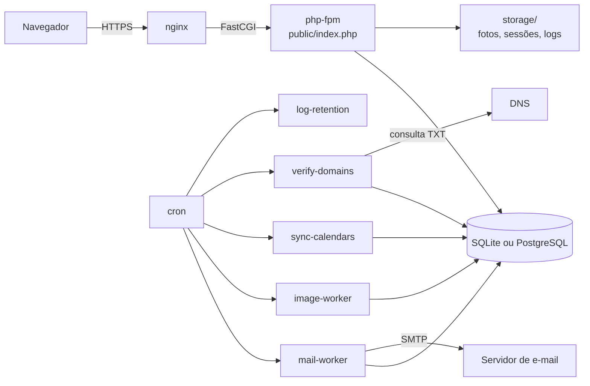
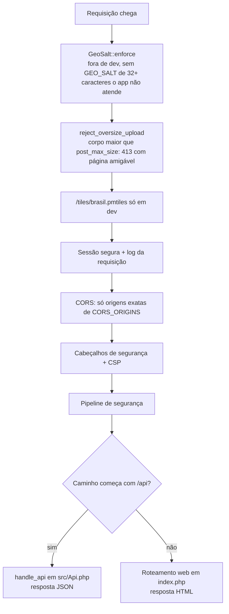
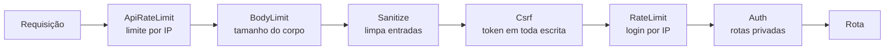
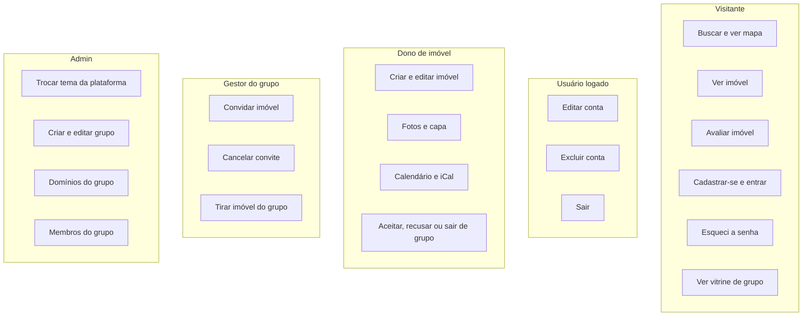
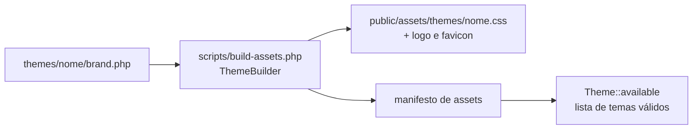
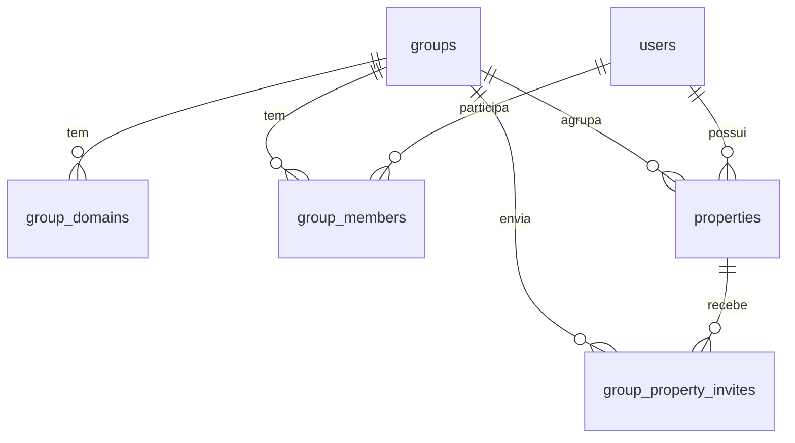
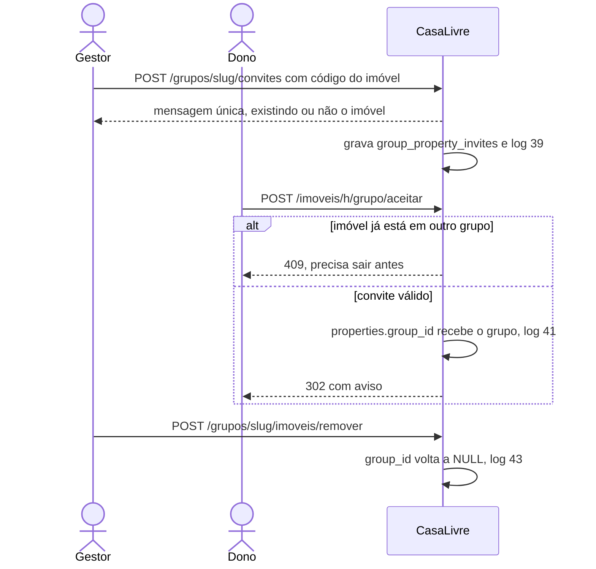
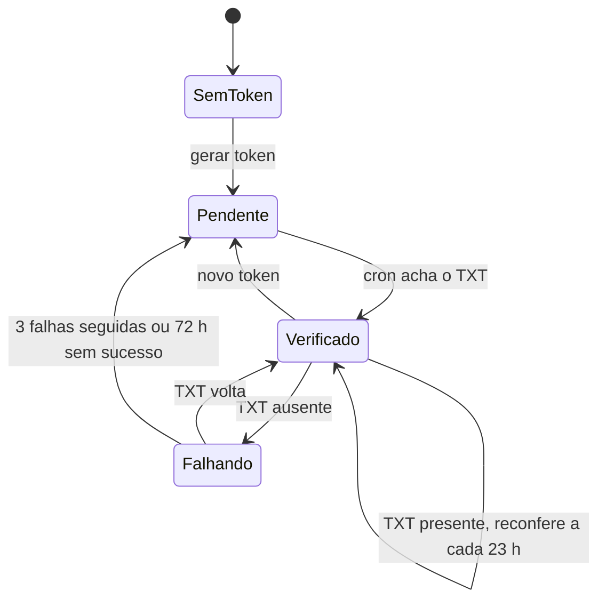
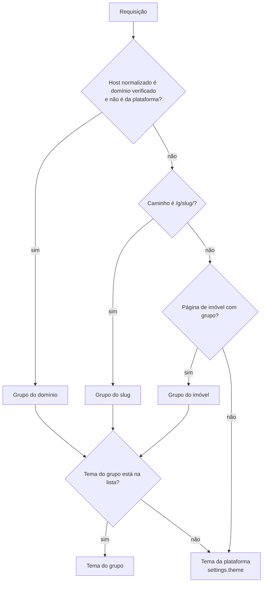
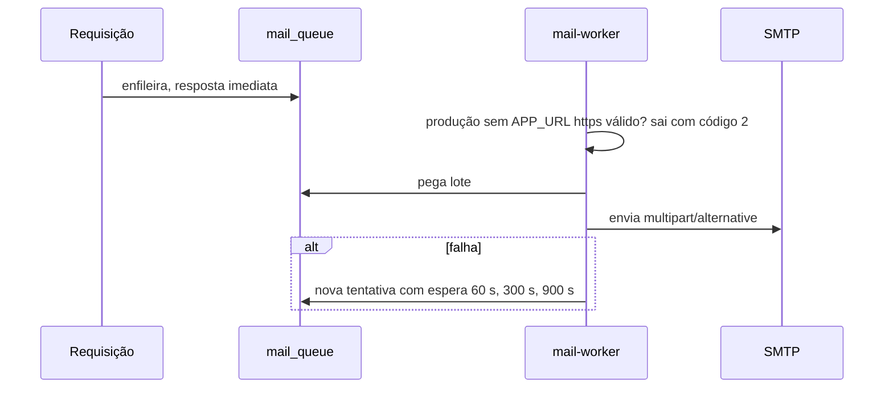

# Arquitetura do CasaLivre

> Documento didático, escrito para quem está começando em TI (estágio, faculdade, primeiro emprego).
> Estado: `develop` ao fim da Sprint 3 (até o PR #69), `SCHEMA_VERSION = 13`.
> Toda rota, código de resposta e limite citado aqui foi conferido no código (`public/index.php`, `src/Api.php`,
> `seguranca/`, `src/Acoes/`, `src/*RateLimit*`). Onde algo depende do servidor (nginx, DNS) e não está no repositório,
> o texto marca **[não verificado no código]**.

## Sumário

1. [Visão geral](#1-visão-geral)
2. [Como uma requisição atravessa o sistema](#2-como-uma-requisição-atravessa-o-sistema)
3. [Segurança: o pipeline e os cabeçalhos](#3-segurança-o-pipeline-e-os-cabeçalhos)
4. [Quem faz o quê: ações por ator](#4-quem-faz-o-quê-ações-por-ator)
5. [Rotas web](#5-rotas-web)
6. [Rotas da API](#6-rotas-da-api)
7. [Limites de taxa (rate limit)](#7-limites-de-taxa-rate-limit)
8. [Temas](#8-temas)
9. [Grupos, papéis e convites](#9-grupos-papéis-e-convites)
10. [Domínios próprios e verificação por DNS](#10-domínios-próprios-e-verificação-por-dns)
11. [O resolvedor de grupo/tema](#11-o-resolvedor-de-grupotema)
12. [A vitrine `/g/<slug>/`](#12-a-vitrine-gslug)
13. [Links por domínio (`GrupoUrl`)](#13-links-por-domínio-grupourl)
14. [E-mail: fila, worker e HTML](#14-e-mail-fila-worker-e-html)
15. [Filas, workers e crons](#15-filas-workers-e-crons)
16. [Banco de dados e `SCHEMA_VERSION`](#16-banco-de-dados-e-schema_version)
17. [Deploy e operação: variáveis de ambiente](#17-deploy-e-operação-variáveis-de-ambiente)
18. [Glossário](#18-glossário)

---

## 1. Visão geral

O CasaLivre é um site de aluguel de temporada: donos cadastram imóveis, visitantes buscam e avaliam, e grupos
(por exemplo, uma associação de moradores de uma praia) podem ter uma vitrine própria, com tema visual e até domínio
próprio.

| Peça | Escolha | Por quê |
|---|---|---|
| Linguagem | PHP (o `composer.json` pede `>=8.2`; desenvolvimento e testes em 8.4) | Hospedagem barata e simples; um processo por requisição evita estado compartilhado. |
| Framework | Nenhum | Menos dependências para auditar; cada camada fica visível no código. |
| Banco | SQLite (PostgreSQL opcional via `DB_DRIVER`/`DB_DSN`) | Um arquivo, backup trivial; o mesmo SQL roda nos dois. |
| Front | HTML renderizado no servidor + JS próprio (`public/assets/`) | Funciona sem JS; a CSP proíbe script inline. |
| Trabalho pesado | Filas no banco + workers por cron | E-mail e imagens não travam a requisição do usuário. |

**Pastas principais:** `public/` (única pasta exposta pelo servidor web), `src/` (domínio e infraestrutura),
`src/Acoes/` (casos de uso: uma classe por ação, que devolve um `Resultado`), `conta/` (sessão e autenticação),
`seguranca/` (middlewares), `views/` (templates), `themes/` (temas), `scripts/` (CLI e crons), `tests/standalone/` (testes).

> **Por que `src/Acoes/`?** A mesma ação (ex.: salvar calendário) é chamada pela rota web e pela API. Pondo a regra numa
> classe só, as duas portas de entrada não divergem; a rota vira só um "adaptador" que traduz o `Resultado` em HTTP.

---

## 2. Como uma requisição atravessa o sistema

Tudo entra por `public/index.php`. A ordem importa, e cada etapa existe por um motivo:

- **Fail closed** (falhar fechado): se falta um segredo obrigatório, é melhor o site não abrir do que abrir inseguro.
- O 413 de upload roda antes de tudo porque, quando o PHP descarta um corpo grande demais, `$_POST` chega vazio e o
  usuário veria um erro de CSRF confuso. A página explica o tamanho enviado e o limite.

---

## 3. Segurança: o pipeline e os cabeçalhos

### 3.1 Pipeline (`seguranca/Seguranca.php`)

Cada middleware olha a requisição e deixa passar ou recusa. A ordem é:

| Middleware | Recusa com | Detalhe conferido |
|---|---|---|
| `ApiRateLimit` | **429** + `Retry-After` | Tabela da seção 7. |
| `BodyLimit` | **411** / **413** | Só em POST/PUT/PATCH/DELETE. `multipart/form-data` fica de fora: o limite real dele é o `client_max_body_size` do nginx **[não verificado no código]**; o `post_max_size` do PHP só é checado depois que o PHP já leu o corpo. `Transfer-Encoding` ou falta de `Content-Length` → 411 (DELETE sem corpo passa). Mais de `MAX_BYTES = 1048576` (1 MiB) → 413. |
| `Sanitize` | — | Normaliza entradas; algumas rotas ficam "puras" (sem sanitizar). |
| `Csrf` | **419** | Compara o token da sessão com `_csrf` do corpo ou o cabeçalho `X-CSRF-Token` (`hash_equals`). A API também confere sozinha (419 em `handle_api`). |
| `RateLimit` | **429** + `Retry-After` | `POST /entrar` e `POST /api/sessao` com IP bloqueado (`LoginRateLimiter`). |
| `Auth` | **302** para `/entrar` (web) / **401** (`/api`) | Rotas da lista `casa_privado` (abaixo) exigem sessão. |

**Por que essa ordem?** O mais barato e o que protege o servidor vem primeiro: contar requisições custa menos que ler o
corpo; recusar um corpo gigante antes de lê-lo evita gastar memória; o CSRF vem antes do login para que um site de
terceiros não consiga nem *tentar* senhas em nome do navegador da vítima.

**Rotas privadas (`casa_privado`)** – sem sessão, a camada `Auth` já recusa:
`/painel`, `/conta`, `/conta/excluir`, `/imoveis/novo`, `/sair`, `/admin/tema`, `/grupos*`, `/admin/grupos*`,
`/imoveis/<h>/grupo/*`, `POST /imoveis`, escrita em `/imoveis/<h>`, `/imoveis/<h>/(editar|fotos|calendario|ical|excluir)…`,
`/api/users/eu*`, `POST /api/casas` e escrita em `/api/casas/<h>`.

Depois, dentro da rota, `require_user` (sem login → 302 `/entrar`) e `require_admin` (sem login → `/entrar`; logado
sem ser admin → **403** "Acesso negado") fazem a checagem fina. São duas camadas de propósito: se alguém esquecer de
pôr uma rota nova na lista, a checagem da própria rota ainda segura (defesa em profundidade).

### 3.2 Cabeçalhos

| Cabeçalho | Valor | Para quê |
|---|---|---|
| `X-Content-Type-Options` | `nosniff` | O navegador não "adivinha" o tipo do arquivo. |
| `X-Frame-Options` | `DENY` | Ninguém põe o site num iframe (clickjacking). |
| `Referrer-Policy` | `same-origin` | Endereços internos não vazam para outros sites. |
| `Content-Security-Policy` | `default-src 'self'; script-src 'self'; style-src 'self'; style-src-attr 'none'; img-src 'self'; connect-src 'self'; worker-src 'self'; object-src 'none'; base-uri 'none'; frame-ancestors 'none'; …` | Só recursos do próprio site; nenhum script ou estilo inline. Uma XSS injetada não executa. |
| `Cache-Control` (HTML) | `private, no-cache` | Páginas não ficam em cache compartilhado (proxy) e são revalidadas. Se a sessão já mandou `no-store`, vale o mais restrito. |
| CORS | só a origem exata listada em `CORS_ORIGINS` | `*` é ignorado de propósito. |

A sessão usa cookie `SameSite` vindo de `SESSION_SAMESITE` (padrão `Lax`; `None` sem HTTPS volta para `Lax`, porque
`None` exige `Secure`).

---

## 4. Quem faz o quê: ações por ator

### Visitante (sem login)
- Buscar (`/busca`, `/busca/mapa`, `/api/busca`), autocompletar cidade (`/api/cidades`) e CEP (`/api/ceps`).
- Ver um imóvel ativo (`/imoveis/<h>`) e avaliá-lo (`POST /imoveis/<h>/avaliar`; precisa de CSRF, não de login).
- Navegar na vitrine de um grupo (`/g/<slug>/`) ou no domínio próprio do grupo.
- Cadastrar-se, confirmar o e-mail (`/verificar`), entrar, pedir e redefinir senha.
- Trocar o idioma (`POST /idioma`).
- Assinar o calendário público de um imóvel (`/ical/<32hex>`).

### Usuário logado
- Painel (`/painel`), conta (`/conta`: nome, e-mail, senha), excluir a conta (`/conta/excluir`), sair (`/sair`).
- Ver os próprios grupos (`/grupos`).

### Dono de imóvel
- Criar (`/imoveis/novo`, `POST /imoveis`), editar e excluir imóvel.
- Fotos: enviar (até `max_photos_per_property`, padrão 40; 16 MB por arquivo; JPG, PNG ou WebP), excluir, escolher capa.
- Calendário: marcar noites, importar feeds iCal de outros sites, excluir feed.
- Grupo: aceitar ou recusar o convite de um grupo e tirar o imóvel do grupo (`/imoveis/<h>/grupo/(aceitar|recusar|sair)`).
  O vínculo `properties.group_id` **só nasce no aceite**: um gestor não consegue pôr um imóvel no grupo sem o dono.

### Gestor do grupo (papel `gestor` em `group_members`)
- Ver o grupo e o link da vitrine (`/grupos/<slug>`), convidar imóvel pelo código, cancelar convite, tirar imóvel.
- O papel `membro` só vê; quem não é gestor *daquele* grupo recebe "não encontrado" (não "proibido": não revelamos
  que o grupo existe).

### Admin (`users.is_admin = 1`)
- Trocar o tema da plataforma (`/admin/tema`).
- Criar grupo, editar nome e tema, incluir/remover domínio, gerar novo token e pedir "verificar agora",
  incluir/trocar papel/remover membro (`/admin/grupos*`).
- Promover alguém a admin é só por linha de comando (`scripts/set-admin.php`), nunca pela web.

---

## 5. Rotas web

Legenda: **S** = exige sessão; **C** = exige CSRF (todo método de escrita); **A** = admin; **RL** = limite de taxa.
`<h>` = código público de 16 hexadecimais do imóvel. Nas rotas do dono, imóvel de outra pessoa → 404 em texto "Imóvel não encontrado.".
Nas telas de grupo, `Resultado` inválido → 422, outro erro → 409 (a tela é mostrada de novo com a mensagem), não encontrado → 404, sucesso → 302 com aviso.

### 5.1 Públicas

| Método | Caminho | Auth | Respostas |
|---|---|---|---|
| GET | `/` | — | 200; com `localidade`, `checkin` ou `checkout` → 302 `/busca` mantendo a query |
| GET | `/busca`, `/busca/mapa` | — | 200 |
| GET | `/g/<slug>/`, `/g/<slug>/busca`, `/g/<slug>/busca/mapa`, `/g/<slug>/imoveis/<h>` | — | 200; grupo inexistente ou de outro domínio verificado → 404; `/g/<slug>` sem barra → 302 com a query |
| GET | `/imoveis/<h>` | — | 200; inativo/inexistente → 404 |
| POST | `/imoveis/<h>/avaliar` | C, RL | 302; inativo → 404 |
| GET | `/ical/<32hex>` | — | 200 `text/calendar`; imóvel inativo → 404 |
| GET | `/imoveis/<h>/calendario.ics` | — | sempre 404 (endereço antigo desativado) |
| POST | `/idioma` | C | 302 para o Referer do mesmo host, senão `/` |
| GET/POST | `/cadastro` | C no POST, RL | POST → tela "verifique seu e-mail" (mesma resposta para e-mail novo ou existente) |
| GET | `/verificar` | — | 200 |
| GET/POST | `/entrar` | C no POST, RL login | sucesso → 302 `/painel`; pendente → tela de verificação; bloqueado → 429 |
| GET/POST | `/senha/esqueci` | C no POST, RL | sempre a mesma mensagem (anti-enumeração) |
| GET/POST | `/senha/redefinir` | C no POST | 200 / 302 |
| GET | `/tiles/brasil.pmtiles` | — | só quando `MapTiles::devRouteEnabled` (em produção quem serve é o nginx) |
| * | qualquer outra | — | 404 |

### 5.2 Usuário logado e dono

| Método | Caminho | Auth | Respostas |
|---|---|---|---|
| POST | `/sair` | S, C | 302 |
| GET/POST | `/conta` | S, C | sucesso → 302 `/painel`; erro → 200 com a mensagem no formulário |
| POST | `/conta/excluir` | S, C | 302 `/` |
| GET | `/painel` | S | 200 |
| GET | `/imoveis/novo` | S | 200 |
| POST | `/imoveis` | S, C | 302 `/imoveis/<h>/editar`; erro → 200 com o formulário |
| GET | `/imoveis/<h>/editar` | S, dono | 200; alheio → 404 texto "Imóvel não encontrado." |
| POST | `/imoveis/<h>` | S, C, dono | 302 `.../editar`; erro → 200 com o formulário |
| POST | `/imoveis/<h>/excluir` | S, C, dono | 302 `/painel` |
| POST | `/imoveis/<h>/fotos` | S, C, dono, RL | 302; acima do `post_max_size` → 413 (o limite de corpo de fato é o `client_max_body_size` do nginx, definido no deploy **[não verificado no código]**) |
| POST | `/imoveis/<h>/fotos/excluir`, `/imoveis/<h>/fotos/<id>/excluir` | S, C, dono | 302 |
| POST | `/imoveis/<h>/fotos/capa`, `/imoveis/<h>/fotos/<id>/capa` | S, C, dono | 302 |
| GET/POST | `/imoveis/<h>/calendario` | S, C no POST, dono | 200 (o POST mostra a tela de novo com a mensagem) |
| POST | `/imoveis/<h>/ical/importar` | S, C, dono | 200 com a tela do calendário e a mensagem |
| POST | `/imoveis/<h>/ical/<id>/excluir` | S, C, dono | 302 `.../calendario` |
| POST | `/imoveis/<h>/grupo/aceitar`, `/recusar`, `/sair` | S, C, dono | 302 com aviso; 404 / 409 / 422 conforme o `Resultado` |

### 5.3 Gestor de grupo

| Método | Caminho | Auth | Respostas |
|---|---|---|---|
| GET | `/grupos` | S | 200 (grupos dos quais sou membro ativo) |
| GET | `/grupos/<slug>` | S, membro | 200; sem vínculo → 404 |
| POST | `/grupos/<slug>/convites` | S, C, gestor | 302 com aviso (mensagem única para inexistente/inativo/já convidado) |
| POST | `/grupos/<slug>/convites/cancelar` | S, C, gestor | 302 |
| POST | `/grupos/<slug>/imoveis/remover` | S, C, gestor | 302 |

GET só sem ação e POST só com ação: qualquer outra combinação é 404.

### 5.4 Admin

| Método | Caminho | Auth | Respostas |
|---|---|---|---|
| GET/POST | `/admin/tema` | S, C, A | 302 `?ok=1`; 422 tema inválido; 409 conflito (troca concorrente ou banco ocupado) |
| GET/POST | `/admin/grupos` | S, C, A | 200 / 302; 422 inválido |
| GET/POST | `/admin/grupos/<slug>` | S, C, A | GET mostra o grupo; POST edita nome/tema |
| POST | `/admin/grupos/<slug>/dominios`, `/dominios/remover`, `/dominios/token`, `/dominios/verificar` | S, C, A | 302 com aviso; 422 / 409 / 404 |
| POST | `/admin/grupos/<slug>/membros`, `/membros/remover` | S, C, A | idem |

Nenhuma rota de admin, grupo ou domínio tem limite de taxa (são autenticadas e raras).

---

## 6. Rotas da API

Respostas em JSON; erro sempre como `{"error": "..."}`. Toda escrita confere o CSRF (419).
Sem sessão, o 401 de `/api/painel` e de `/api/imoveis/<h>/(calendario|editar|fotos/capa|ical/*)` vem só de `api_require_user`, chamado na própria rota: essas rotas **não** estão em `casa_privado`, então ali há uma camada só. (`/api/users/eu*` e `/api/casas*` têm também a camada `Auth` do pipeline e a trava geral em `handle_api`.)

| Método | Caminho | Auth | Respostas |
|---|---|---|---|
| POST | `/api/sessao` | C, RL login | 200 `{user}`; 401 senha errada; 423 conta bloqueada; 429 IP bloqueado; 403 apagada/inativa/pendente (só com a senha certa; pendente reenvia a ativação como a web e devolve `expires`) |
| DELETE | `/api/sessao` | C | 200 |
| POST | `/api/users` | C, RL | 201 `{status: pending}` (igual para e-mail novo ou existente); 422 |
| GET | `/api/users/eu` | S | 200 |
| PUT | `/api/users/eu` | S, C | 200; 422 |
| DELETE | `/api/users/eu` | S, C | 200 |
| POST | `/api/auth/verificar` | C | 200; 400 token inválido |
| POST | `/api/auth/senha/esqueci` | C, RL | sempre 200 |
| POST | `/api/auth/senha/redefinir` | C | 200; 422 |
| POST | `/api/idioma` | C | 200; 422 idioma inválido |
| GET | `/api/cidades` | RL | 200 |
| GET | `/api/ceps` | RL | 200; 422 formato; 404 não achado |
| GET | `/api/busca` | RL | 200 `{items, facets, searched, filters}` (coordenadas públicas deslocadas, nunca as exatas) |
| GET | `/api/imoveis/<h>` | — | 200; 404 |
| POST | `/api/imoveis/<h>/avaliar` | C, RL | 201; 422; 404 |
| GET | `/api/painel` | S | 200 |
| GET | `/api/casas` | S | 200 |
| POST | `/api/casas` | S, C | 201; 422 |
| GET / PUT / DELETE | `/api/casas/<h>` | S, dono | 200; 422 no PUT; DELETE marca `estado: inativo` |
| POST | `/api/casas/<h>/fotos` | S, C, dono, RL | 201 |
| DELETE | `/api/casas/<h>/fotos/<id>` | S, C, dono | 200; 404 |
| POST | `/api/imoveis/<h>/fotos/capa` | S, C, dono | 200; 422 sem `foto_id` |
| GET | `/api/imoveis/<h>/calendario` | S, dono | 200 |
| POST | `/api/imoveis/<h>/calendario` | S, C, dono | 200 |
| GET | `/api/imoveis/<h>/editar` | S, dono | 200 |
| POST | `/api/imoveis/<h>/ical/importar` | S, C, dono | 200; falha ao baixar o feed → também 200 (`ok: true`, `status: NOK`, mensagem); 422 URL/limite/título; 409 feed duplicado |
| DELETE | `/api/imoveis/<h>/ical/<id>` | S, C, dono | 200; 404 |
| GET | `/api/ical/<32hex>` (com ou sem `.ics`) | — | 200; 404 |
| GET | `/api/imoveis/<h>/calendario.ics` | — | sempre 404 |
| * | outra | — | 404 "Rota não encontrada." |

Grupos, domínios e temas **não** têm API: só as telas web. A busca da API respeita o domínio (seção 12).

---

## 7. Limites de taxa (rate limit)

Contagem por IP (IPv6 agrupado por /64, porque um único cliente costuma ter um /64 inteiro). Ao estourar: 429 com
`Retry-After`. Os contadores ficam em arquivos (`storage/cache/ratelimit`, que se limpa sozinho, até `MAX_FILES = 20000`).

| Rota(s) | Limite | Balde |
|---|---|---|
| `GET /api/cidades`, `GET /api/ceps`, `GET /api/busca` | 60 por 60 s | um por rota |
| `POST /api/auth/senha/esqueci` e `POST /senha/esqueci` | 5 por 900 s | **compartilhado** |
| `POST /api/users` e `POST /cadastro` | 10 por 3600 s | **compartilhado** |
| `POST /api/imoveis/*/avaliar` e `POST /imoveis/*/avaliar` | 10 por 3600 s | **compartilhado** |
| `POST /api/casas/*/fotos` e `POST /imoveis/*/fotos` | 30 por 600 s | **compartilhado** |
| `POST /entrar`, `POST /api/sessao` | `login_ip_max_failures` (5) erros → bloqueio de `login_ip_lock_minutes` (15) min | `LoginRateLimiter` (tabela `login_rate_limit`) |
| Reenvio de ativação (login de conta pendente, web e API) | 3 por 3600 s **por conta** (não por IP); só conta o e-mail que entra de fato na fila | `LoginAttempt` (`ativacao-reenvio`) |

> **Por que baldes compartilhados?** Se web e API tivessem baldes separados, um robô dobraria o limite só alternando as
> portas de entrada.

Além do IP, a conta tem bloqueio próprio (`login_max_failures`, 5), que vira 423 na API.

---

## 8. Temas

Um tema é uma pasta `themes/<nome>/` com um `brand.php` (nome da marca, rótulo, logo, favicon e tokens de cor).
Hoje existem `padrao` e `contraste`.

- **Só existe tema que está no manifesto** e cujo nome casa com `NAME_RE` (sem `/`, `.` ou `..`). Assim um valor
  vindo do banco nunca vira caminho de arquivo fora de `themes/` (path traversal).
- `settings.theme` fora da lista cai no `padrao`.
- O admin troca o tema em `/admin/tema` (`ThemeSet`): atualização condicional ("só troca se ainda for o anterior");
  troca concorrente ou banco ocupado → 409, nunca 500. Log 32 (`THEME_CHANGE`).
- O CSS do tema é um arquivo estático: a CSP continua `style-src 'self'`, sem estilo inline.

---

## 9. Grupos, papéis e convites

- **Slug**: `^[a-z0-9](?:[a-z0-9-]{0,38}[a-z0-9])?$` (até 40 caracteres, sem hífen nas pontas). Nome até 80 caracteres.
- **Papéis**: `gestor` e `membro` (`GrupoValidacao::ROLES`). Admin é da plataforma, não do grupo.
- **Domínios**: até 10 por grupo (`MAX_DOMAINS`), nunca o da plataforma nem subdomínio dele.
- Cada ação mora numa classe: `GrupoAdmin` (admin), `GrupoGestor` (gestor), `GrupoDono` (dono do imóvel).
  Sem permissão, a resposta é sempre `nao_encontrado` (404): não confirmamos que o recurso existe.
- Toda mudança grava no `activity_log`; ação sem efeito não loga.

Códigos de log dos grupos: 33 criar, 34 editar, 35/36 domínio incluído/removido, 37/38 membro definido/removido,
39 convite, 40 convite cancelado, 41 aceito, 42 recusado, 43 imóvel removido, 44 novo token, 45 domínio verificado,
46 domínio perdeu a verificação.

> **Por que "mensagem única" no convite?** Se a resposta mudasse para "imóvel não existe", um gestor poderia varrer
> códigos e descobrir quais imóveis existem ou estão inativos (enumeração).

---

## 10. Domínios próprios e verificação por DNS

Um grupo pode ter o próprio domínio (ex.: `aluguel.praiadosul.org`). Antes de o site responder com o tema e os imóveis
do grupo nesse domínio, é preciso **provar a posse** dele.

1. O admin inclui o domínio e gera um token (`/dominios/token`, log 44).
2. Quem controla o DNS cria o registro `TXT _casalivre.<domínio>` com o valor `casalivre-verificacao=<token>`.
3. O admin clica "verificar agora" (`/dominios/verificar`). **A requisição não consulta o DNS**: só marca o pedido
   (`last_check_at = NULL`). Consultar DNS na requisição deixaria a página lenta e permitiria usar o site para
   disparar consultas.
4. O cron `scripts/verify-domains.php` (a cada hora, `17 * * * *`) confere e grava log 45 quando verifica.

Regras do `DomainReverification` (conferidas): `RECHECK_HOURS = 23`, `MAX_FAILS = 3`, `GRACE_HOURS = 72`.
Consulta que **falhou** (timeout, SERVFAIL) não conta como falha, mas também não segura o domínio para sempre: passado o
prazo de graça, ele perde a verificação. Ao perder, grava log 46 e enfileira um e-mail de aviso para os admins
(`mail_queue`).

---

## 11. O resolvedor de grupo/tema

`GrupoResolvedor::resolver(host, caminho, imóvel)` decide qual grupo e tema valem na página. Cada passo cai no seguinte:

- Só o cabeçalho `Host` (nunca `X-Forwarded-Host`, que o cliente forja à vontade). Host normalizado por
  `GrupoValidacao::host` (minúsculas, sem porta, sem ponto final; IP e IDN unicode → nada).
- Host desconhecido → plataforma, sem redirecionar.
- "Plataforma" = host do `APP_URL` sem `www.` e, se definido, `PLATFORM_ROOT_DOMAIN`, incluindo subdomínios.
- **Isolamento**: no domínio verificado do grupo X, `/g/<Y>/` responde 404 (`grupoDoSlugNoHost`). Senão o domínio de
  um grupo poderia exibir outro grupo com o endereço dele.

---

## 12. A vitrine `/g/<slug>/`

A vitrine é a busca do site filtrada por um grupo, com o tema dele.

- `/g/<slug>/`, `/g/<slug>/busca`, `/g/<slug>/busca/mapa` e `/g/<slug>/imoveis/<h>`.
- O JS chama `/api/busca?grupo=<slug>`; o filtro é feito **no SQL** (`GroupRepository::searchSource`, só imóveis
  ativos), não depois, para a paginação e as contagens baterem.
- No domínio verificado do grupo X: sem `grupo`, a API devolve só os imóveis de X; com `?grupo=<Y>`, devolve lista vazia.
- Redirecionamentos (`Redirect::withQuery`) são sempre **relativos** e mantêm a query: não há redirecionamento aberto
  para outro site.

---

## 13. Links por domínio (`GrupoUrl`)

E-mails e páginas precisam de links absolutos. **Nunca** os montamos com o `Host` da requisição: um atacante poderia
mandar um `Host` falso e fazer o sistema enviar e-mails com links para o site dele (*host header injection*).

- Grupo com domínio verificado: `https://<primeiro domínio verificado, por id>/g/<slug>` (revalidado; nunca o da plataforma).
- Senão: `APP_URL/g/<slug>` (`Mailer::linkFromAppUrl`).
- Usado nas páginas do grupo (admin e gestor) e no e-mail de aviso de domínio.

---

## 14. E-mail: fila, worker e HTML

- **Fila**: a requisição só enfileira; a resposta não depende do SMTP e leva o mesmo tempo para e-mail existente ou não
  (anti-enumeração). Reenvio com espera mínima (`COOLDOWN_SECONDS = 300`; 86400 para "já tem conta").
  Até 5 tentativas (`MAX_ATTEMPTS`), espera de 60/300/900 s. Itens enviados ficam `MAIL_QUEUE_RETENTION_DAYS` (padrão 7).
- **`APP_URL` obrigatório**: em produção o worker se recusa a iniciar sem um `APP_URL` válido. Sai com código 2,
  mensagem no stderr, e **não toca na fila**. Melhor não enviar do que enviar links quebrados.
- **HTML** (`MailHtml`): `multipart/alternative` com a parte texto primeiro (fallback). Cabeçalho, rodapé e cor do tema
  (cor aceita só `#rgb` ou `#rrggbb`). Todo dado escapado com `htmlspecialchars(ENT_QUOTES|ENT_HTML5, UTF-8)`;
  sem imagens remotas, sem script, CSS só inline. Links só de `APP_URL` ou domínio verificado `https`.
  Assunto e nomes protegidos contra injeção de cabeçalho. `MAIL_HTML=0` desliga a parte HTML.

---

## 15. Filas, workers e crons

| Script | Cron sugerido | O que faz |
|---|---|---|
| `scripts/mail-worker.php` | `* * * * *` | Envia a fila de e-mail. |
| `scripts/image-worker.php` | `* * * * *` | Gera variantes das fotos (até 25 megapixels; `memory_limit` ≥ 256M). |
| `scripts/sync-calendars.php` | `0 * * * *` | Importa feeds iCal e apara noites além do horizonte. |
| `scripts/verify-domains.php` | `17 * * * *` | Verifica/reverifica domínios (seção 10). |
| `scripts/log-retention.php` | `15 3 * * *` (ou runit `deploy/runit/casalivre-log-retention`) | Apaga logs com mais de 14 dias. |

Filas no banco (`JobQueue`): job "preso" há mais de `STALE_SECONDS = 600` volta para a fila; cada worker roda no máximo
`600 − 120 = 480` s para não se sobrepor ao próximo cron.

> **Por que minuto 17?** Espalhar os crons horários evita que todos batam no banco no minuto 0.

---

## 16. Banco de dados e `SCHEMA_VERSION`

`Db::SCHEMA_VERSION = 13`. A cada requisição o app compara a versão gravada no banco (`PRAGMA user_version` no SQLite)
com a do código e só migra quando o banco está atrás; `scripts/migrate.php` força a migração no deploy.
Histórico recente (comentário em `src/Db.php`):

| Versão | Mudança |
|---|---|
| 7 | Fotos assíncronas (`photos.status/uuid/original`, `image_queue`) |
| 8 | `users.is_admin` + `settings.theme` (temas) |
| 9 | Seed sem `err.email_taken` |
| 10 | `err.profile_required` |
| 11 | Grupos: `groups`, `group_members`, `group_domains`, `group_property_invites`, `properties.group_id` |
| 12 | `group_domains.verify_token` + `verified_at` (verificação DNS TXT) |
| 13 | `group_domains.last_check_at` + `fail_count` (reverificação pelo cron) |

> **Dica de deploy**: faça backup do arquivo SQLite antes de subir uma versão com `SCHEMA_VERSION` maior.

---

## 17. Deploy e operação: variáveis de ambiente

| Variável | Para quê | Observação |
|---|---|---|
| `APP_ENV` | `production`, `dev`, `local` | Fora de dev, segredos são obrigatórios. |
| `APP_URL` | URL pública (https em produção) | Base dos links de e-mail; define a "plataforma" no resolvedor; sem ela o mail-worker não inicia em produção. |
| `PLATFORM_ROOT_DOMAIN` | Domínio raiz extra da plataforma | Opcional; seus subdomínios nunca viram domínio de grupo. |
| `GEO_SALT` | Sal do deslocamento das coordenadas públicas | ≥ 32 caracteres, obrigatório fora de dev. |
| `LOG_SALT` | Sal do hash de IP nos logs | |
| `DB_DRIVER`, `DB_DSN`, `DB_USER`, `DB_PASSWORD` | Banco | Padrão SQLite. |
| `ACTIVITY_DB_PATH` | Arquivo do `activity.sqlite` | |
| `LOG_DRIVER`, `LOG_MONGO_URI`, `LOG_MONGO_DB` | Destino dos logs | Mongo opcional. |
| `REQUEST_LOG` | Liga o log de requisições | |
| `QUEUE_DRIVER` | Implementação da fila | |
| `SMTP_HOST`, `SMTP_PORT`, `SMTP_USER`, `SMTP_PASS`, `SMTP_SECURE`, `SMTP_FROM`, `SMTP_TIMEOUT`, `SMTP_CA_FILE` | Envio de e-mail | |
| `MAIL_HTML` | `0` desliga a parte HTML | Padrão: ligado. |
| `MAIL_QUEUE_RETENTION_DAYS` | Retenção da fila de e-mail | Padrão 7. |
| `CORS_ORIGINS` (e `CORS_ORIGIN`) | Origens permitidas | Só igualdade exata. |
| `SESSION_SAMESITE` | `Lax` (padrão), `Strict` ou `None` | `None` só com HTTPS. |
| `MAP_TILES_FILE` | Arquivo PMTiles | |
| `CASALIVRE_ENV_FILE` | Caminho do `.env` | |
| `CASOS`, `CASOS_FILA_FOTOS_SEGUNDOS`, `SEM_RETENCAO`, `SO_ICS` | Só para testes e scripts de casos | Não usar em produção. |

**Ordem do deploy:** código → `php scripts/build-assets.php && php scripts/build-assets.php --check` (gera o manifesto,
os CSS de tema e o `map-style.json`; recusa rodar se algum `brand.php` for inválido) → pré-compressão dos assets →
`php scripts/migrate.php` → recarregar o PHP-FPM (com OPcache `validate_timestamps=0`, recarregar é obrigatório).
Para definir o primeiro admin: `php scripts/set-admin.php <email>`.

**Servidor [não verificado no código]** (vem das notas de deploy, não do repositório):
- nginx com um `server` padrão que recusa `Host` desconhecido (`default_server`, `ssl_reject_handshake on; return 444;`),
  e `server_name` só com o host do `APP_URL` e os domínios de grupo **verificados**.
- `fastcgi_param HTTP_HOST $host;` e nunca repassar `X-Forwarded-Host`.
- Não sobrescrever o `Cache-Control` do HTML vindo do PHP; só `/assets/` (immutable) e `/tiles/` têm cache próprio.
- TLS por domínio de grupo só depois de verificado; parar de renovar quando perde a verificação (log 46).
- DNS de saída confiável para o cron de domínios (`resolv.conf` sem `search`, `options timeout:3 attempts:2`).
- `storage/` gravável pelo usuário do php-fpm e do cron (locks, rate limit, `login_dummy_hash.json`).

---

## 18. Glossário

- **CSRF**: ataque em que outro site faz o navegador da vítima enviar um formulário. Defesa: token secreto por sessão.
- **CSP**: lista, enviada pelo servidor, de onde o navegador pode carregar scripts, estilos e imagens.
- **Enumeração**: descobrir quais contas/imóveis existem pelas diferenças nas respostas.
- **Fail closed**: na dúvida, recusar.
- **Gestor**: papel de quem administra um grupo (convites, remoções).
- **Rate limit**: limite de requisições por intervalo de tempo.
- **Resolvedor**: código que decide grupo e tema de uma página.
- **Slug**: identificador curto e legível na URL (`/g/praia-do-sul/`).
- **TXT**: tipo de registro DNS com texto livre, usado para provar posse de domínio.
- **Vitrine**: busca filtrada por grupo, com o tema dele.
- **Worker**: programa que roda fora da requisição e processa uma fila.
