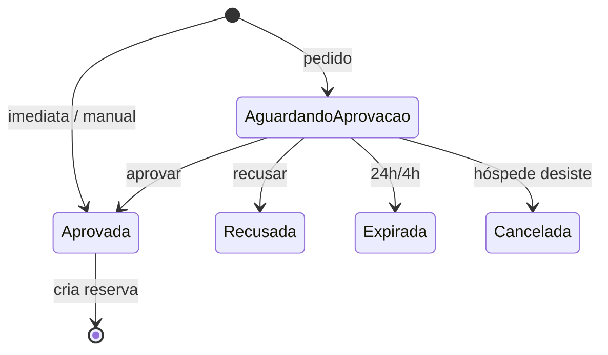
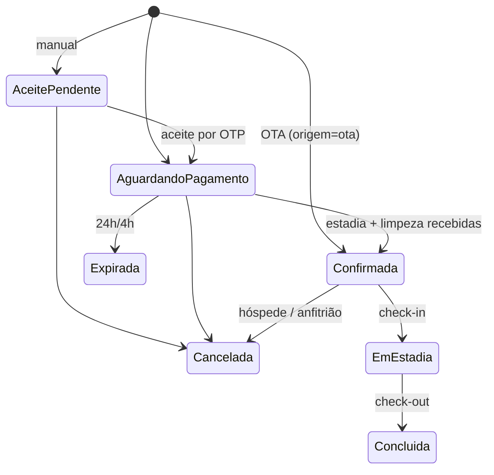
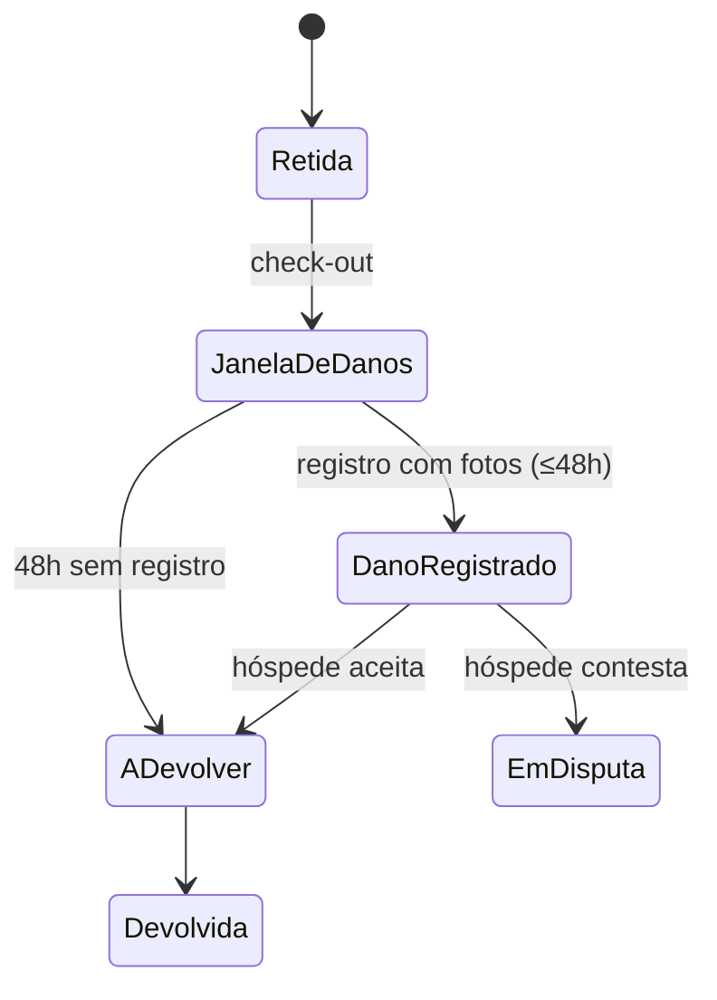
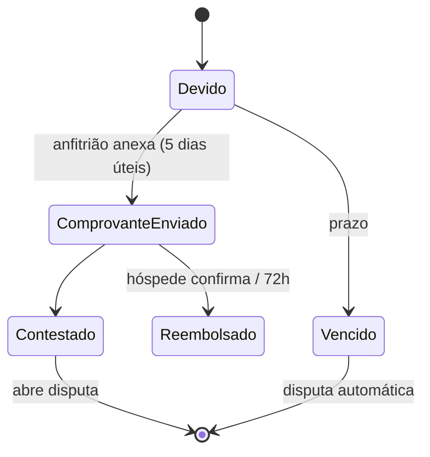
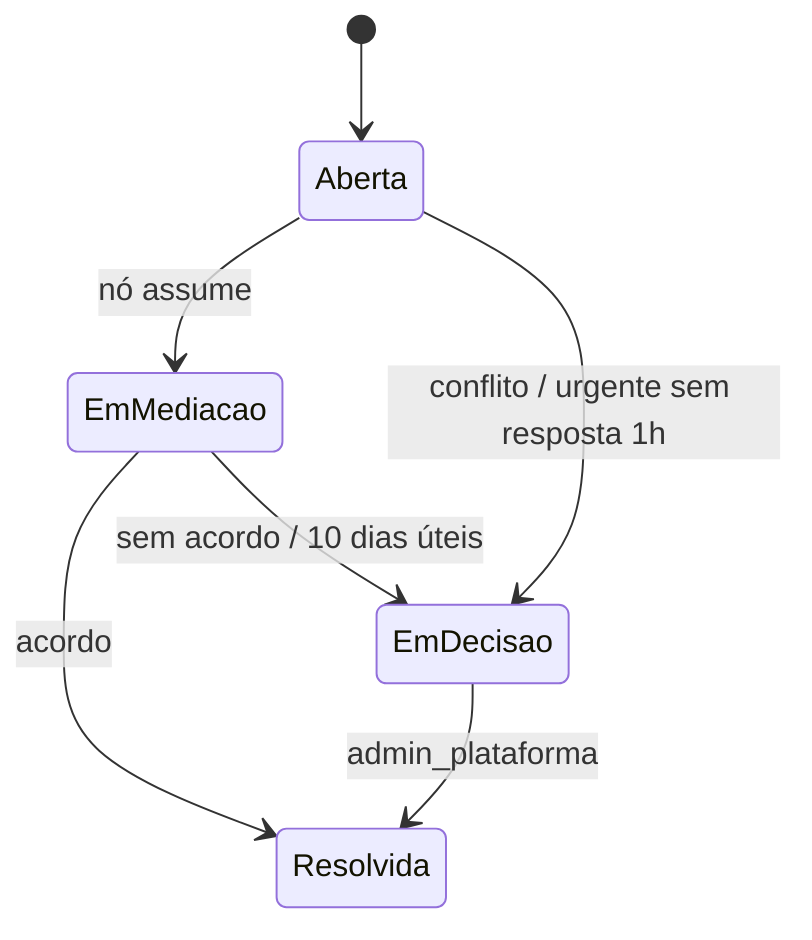

# CasaLivre: Spec 00, índice e contrato comum (v1, 16/10/2026)

Este documento é a referência única de estados, papéis, termos e parâmetros. Se uma spec divergir dele, vale este documento, e a divergência entra na seção 6. Decisões jurídicas: `juridico/parecer-J1-J35.md`. Legenda: **decidido** · **[E]** (estimativa, revisão Negócios) · **[pendente: dono]**.

## 1. Índice
| Spec | Tema | Sprint |
|---|---|---|
| `spec-telas-busca-mapa-upload-fotos.md` | Mapa (MapLibre/PMTiles) e upload de fotos | S5–S7 |
| 01 | Busca, anúncio, identificação (OTP), checkout, Viagens | S7/S8 |
| 02 | Papéis, troca de contexto, fila e "Marcar como pago" (só regras; telas na 06), chave Pix, força maior, exclusão de conta, lista de bloqueio | S5/S7 |
| 03 | Cadastro e publicação do anúncio | S6 |
| 04 | Árvore de organizações, membros, canais e temas, log de auditoria | S5 |
| 05 | Recebedores e KYC, regras de split, ledger, termos; Apêndice A: fatura P9 | S7/S8 |
| 06 | Painel Hoje, fila de aprovação, calendário, portaria, reserva manual | S7 |
| 07 | Avaliações e modelo de preço | S8 |
| 08 | Mensagens, favoritos, comparação | S8 |
| 09 | Viagens do hóspede, cancelamento, reembolso, disputa, comprovante | S8 |
| 10 | Backoffice do admin_plataforma (filas) | S8 |
| `casos-de-uso.md`, `casos-de-uso-admin-proposta.md` | Casos de uso UC-H/UC-P e UC-A01 a A26 | — |

## 2. Máquinas de estado

### 2.1 Solicitação
Origem gravada na criação: **Pedido**, **Imediata**, **OTA**, **Manual** (spec-06 3b).
| De | Para | Gatilho | Quem | Condição | Prazo | Spec |
|---|---|---|---|---|---|---|
| — | Aguardando aprovação | Enviar solicitação | hóspede | identificado por OTP; aprovação manual | — | 01 §5 |
| — | Aprovada | Reservar (instantânea) | hóspede | imóvel com reserva imediata | — | 01, 06 3b |
| — | Aprovada | Lançar reserva manual | proprietário, gestor, operador com permissão de reservas | sem conflito de datas; comissão do canal manual exibida | — | 06 3b |
| Aguardando aprovação | Aprovada | Aprovar | proprietário, gestor, operador (ou nó com delegação) | — | 24 h; 4 h se check-in < 72 h (herdado do nó, sobrescrevível por imóvel) | 02 §2, 06 |
| Aguardando aprovação | Recusada | Recusar (motivo fixo) | idem | confirmação | idem | 02, 06 |
| Aguardando aprovação | Expirada | Prazo vencido | sistema | sem resposta | idem | 01, 02 |
| Aguardando aprovação | Cancelada | Desistir | hóspede | — | — | 09 |
Uma solicitação Aprovada cria a reserva em **Aguardando pagamento**. **Exceção OTA:** a reserva vinda de OTA não passa por solicitação de aprovação nem pagamento casalivre (2.2).

### 2.2 Reserva
| De | Para | Gatilho | Quem | Condição | Prazo | Spec |
|---|---|---|---|---|---|---|
| — | Aguardando pagamento | Solicitação aprovada | sistema | snapshot de preço, política, termos e inventário (Anexo I) | — | 01 §5 |
| — | Aceite pendente | Lançar reserva manual | proprietário, gestor, operador | `origem = manual`; datas bloqueadas; link com OTP enviado ao hóspede | — | 06 3b |
| Aceite pendente | Aguardando pagamento | Aceitar termos e contrato pelo link com OTP | hóspede | aceite gravado (versão, data e hora) | — | 06 3b, 09 |
| Aceite pendente | Aceite pendente | Reenviar link | anfitrião | novo link invalida o anterior; limite de reenvios; log | — | 06 3b |
| Aceite pendente | Cancelada | Cancelar | anfitrião | — | — | 06 3b |
| — | Confirmada | Sincronização OTA (iCal ou parceiro) | sistema | `origem = ota`; **sem etapa de pagamento casalivre**; bloqueia o calendário na hora; **fora do funil de conversão**; o ledger registra só o que a casalivre cobra (Produto; detalhes técnicos: Arquitetura) | imediato | 06 3b |
| Confirmada (OTA) | Cancelada | Cancelamento na OTA | sistema / anfitrião | segue a **política da OTA**, não a do snapshot casalivre | — | 06 3b, 09 §3 |
| Aguardando pagamento | Confirmada | "Estadia recebida" + "Limpeza recebida" (piloto, `pagamento_modo = fora`) | proprietário, gestor; operador só com delegação | as duas marcações; "Desfazer" por 5 s; comissão vira conta a receber | 24 h; 4 h se check-in < 72 h | 02 §3, 06 |
| Aguardando pagamento | Expirada | Prazo vencido | sistema | sem as duas marcações; datas liberadas; contagem antibloqueio (3 seguidas / 7 dias [E]) | idem | 01 |
| Aguardando pagamento | Cancelada | Cancelar | hóspede ou anfitrião | — | — | 09 |
| Confirmada | Em estadia | Data de check-in | sistema | — | — | 09 |
| Confirmada | Cancelada | Cancelar pelo hóspede | hóspede | reembolso: CDC 7 dias da confirmação e antes do check-in = 100%; reembolso integral não gera comissão; senão, a política do snapshot | — | 09 §3 |
| Confirmada | Cancelada | Cancelar pelo anfitrião | proprietário, gestor | hóspede sempre 100%; datas bloqueadas; perde destaque 90 dias; taxa a partir do 2º em 12 meses; força maior não conta | comprovação em 7 dias | 02 §5, 09 §4 |
| Em estadia | Concluída | Data de check-out | sistema | abre avaliação por 14 dias | — | 07, 09 |
| Confirmada / Em estadia / Concluída | em disputa (marcador) | Relatar problema | hóspede, anfitrião, sistema | ver 2.4 | — | 09 §6 |
Cancelamento com valor pago gera um **reembolso** (2.3).

### 2.2b Caução
| De | Para | Gatilho | Quem | Condição | Prazo | Spec |
|---|---|---|---|---|---|---|
| — | Retida | Reserva com caução | sistema | valor definido no anúncio, no snapshot | — | 03, 09 |
| Retida | Janela de danos | Check-out | sistema | — | 48 h | 06 §3d |
| Janela de danos | Dano registrado | Registrar dano com fotos | proprietário, gestor | fotos obrigatórias; itens do Anexo I ou texto | até check-out + 48 h | 06 §3d |
| Janela de danos | A devolver | Prazo vencido sem registro | sistema | — | 48 h | 06, 09 |
| Dano registrado | A devolver (parcial ou total) | Hóspede aceita | hóspede | — | — | 09 |
| Dano registrado | em disputa | Hóspede contesta | hóspede | vai para 2.4 | — | 09 §6 |
| A devolver | Devolvida | Anfitrião marca devolução | proprietário, gestor | — | — | 06 |

### 2.3 Reembolso (piloto, pagamento por fora)
| De | Para | Gatilho | Quem | Condição | Prazo | Spec |
|---|---|---|---|---|---|---|
| — | Devido | Cancelamento com valor a devolver | sistema | valor calculado no servidor | — | 09 §4 |
| Devido | Comprovante enviado | Anexar comprovante Pix com ID da transação | proprietário, gestor | — | 5 dias úteis | 09 §4 |
| Comprovante enviado | Reembolsado | Confirmar | hóspede | — | — | 09 |
| Comprovante enviado | Reembolsado | Silêncio do hóspede | sistema | — | 72 h | 09 |
| Comprovante enviado | Contestado → disputa | Contestar | hóspede | — | antes das 72 h | 09 |
| Devido | Vencido → disputa automática | Prazo vencido | sistema | anúncios param de aceitar reservas; o atraso não gera comissão (penalidades existentes); o proprietário perde o pagamento por fora; hóspede recebe orientação Procon e declaração da plataforma (parecer item 22) | 5 dias úteis | 09, 10 §2.3 |

### 2.4 Disputa
| De | Para | Gatilho | Quem | Condição | Prazo | Spec |
|---|---|---|---|---|---|---|
| — | Aberta | Relatar problema | hóspede ou anfitrião | até 14 dias após check-out ou até o fim do prazo de reembolso; problema de check-in em 24 h da entrada, com fotos | — | 09 §6 |
| — | Aberta | Reembolso contestado ou vencido | sistema | — | — | 09 §4 |
| — | Aberta + URGENTE | Marcar urgente | sistema / moderação | segurança física, hóspede sem acesso, suspeita de golpe | nó assume em 1 h | 10 §2.2b |
| Aberta | Em mediação (nó) | Assumir | admin do nó acima | sem conflito de interesse | — | 09, 10 |
| Em mediação | Resolvida | Acordo | mediador | registro da decisão | 10 dias úteis | 09 |
| Aberta / Em mediação | Em decisão (plataforma) | Escalar | sistema ou mediador | conflito de interesse, sem acordo, prazo vencido, ou URGENTE não assumido em 1 h | URGENTE: 4 h em horário comercial | 09, 10 |
| Em decisão | Resolvida | Decidir em definitivo | admin_plataforma | — | — | 10 §2.3 |
Retenção: fotos e mensagens 12 meses após a resolução; resultado e log 5 anos (J33).

## 3. Papéis × ações
"franqueado" **não é um papel do sistema**: é um **admin_org** (ou gestor) num nó do tipo franquia, e também um **recebedor** (corretor-franqueado). **recebedor** é um cadastro de pagamento (KYC), não um papel de acesso. ✓ = pode · D = só com delegação explícita · E = escopo (sub-árvore / imóveis próprios) · — = oculto.
| Ação | admin_plataforma | admin_org | gestor | operador | proprietário | hóspede | Spec |
|---|---|---|---|---|---|---|---|
| Buscar, solicitar, pagar, cancelar a própria reserva | ✓ como hóspede | ✓ como hóspede | ✓ como hóspede | ✓ como hóspede | ✓ como hóspede | ✓ | 01, 09 |
| Aprovar / recusar solicitação | ver | ver | ✓ E | ✓ E | ✓ (se não delegou) | — | 02, 06 |
| Marcar estadia/limpeza recebida | — | — | ✓ E | D | ✓ | — | 02 §3 |
| Lançar reserva manual | — | — | ✓ E | ✓ E (permissão de reservas) | ✓ | — | 06 3b |
| Calendário e preço | ver | ver | ✓ E | ver | ✓ | — | 06, 07 |
| Criar/publicar anúncio | ver | ver | ✓ E | — | ✓ | — | 03 |
| Chave Pix / recebedor | ver mascarada | ver mascarada | D | — | ✓ (OTP, 48 h) | — | 02 §4, 05 |
| Aprovar KYC; ver documentos KYC | ✓ (único) | só status | só status | — | só o próprio | — | 05 |
| Editar regra de split; termos | ✓ | ver no escopo | — | — | ver extrato | — | 05 |
| Fechar mês P9 (fatura da casalivre) | ✓ | ver no escopo; emite a do franqueado | — | — | ver extrato por emissor | — | 05 Ap. A |
| Árvore, membros, convites | ✓ cria e move | ✓ cria filhos, E | ✓ membros, E | — | coanfitrião | — | 04 |
| Canais e temas | ✓ todos | ✓ canais do nó | ✓ se o canal é do nó | — | — | — | 04 |
| Log de auditoria (ver / exportar) | ✓ (exportar com reautenticação) | ✓ E | — | — | — | — | 04 |
| Decidir força maior | recurso e conflito | ✓ nó acima | ✓ nó acima | — | envia prova | — | 02 §5, 10 |
| Mediar disputa | decisão final | ✓ nó acima | ✓ nó acima | — | parte | parte | 09, 10 |
| Moderar avaliações/mensagens | decide | triagem no escopo | — | — | responde em público (48 h) | denuncia | 07, 08, 10 |
| Ler conversa alheia | só com denúncia/disputa, motivo, log e aviso | — | — | — | — | — | 08 |
| Lista de bloqueio, correção de Pix por vídeo | ✓ (quem atende ≠ quem aprova) | — | — | — | — | — | 10 |
| Assumir item de fila no mobile | ✓ (única ação no mobile) | ✓ no escopo | — | — | — | — | 10 |
**Delegações** (spec-02, 04): aprovação delegável a um nó ou a uma pessoa; "marcar pago" delegável ao operador; a chave Pix do gestor só com delegação explícita e OTP do proprietário. Toda ação delegada vai ao log com o delegante.

## 4. Glossário canônico
| Termo canônico | Definição | Não usar |
|---|---|---|
| anfitrião | quem opera a reserva do imóvel (proprietário ou equipe) | host, locador |
| proprietário | dono do imóvel e titular do recebimento da estadia | dono, locatário |
| hóspede | quem reserva | cliente, inquilino |
| nó | ponto da árvore de gestão (profundidade livre) | filial, nível |
| organização | nó com `tipo` (rede, franquia, **Imobiliária** etc. são só rótulos). **"Imobiliária" é um tipo permitido** para organizações clientes que de fato são imobiliárias | "rede" como termo genérico |
| admin_org | administrador de um nó | admin_rede, admin da rede |
| franqueado | admin_org/gestor de nó franquia; também recebedor | papel "franqueado" |
| canal | vitrine de distribuição (marketplace, site do nó, OTA) | site, vitrine própria |
| recebedor | cadastro com KYC que recebe uma parcela | beneficiário, favorecido |
| origem | Pedido, Imediata, OTA, Manual | fonte, tipo de reserva |
| emissor da cobrança | quem fatura uma parcela do split (casalivre, franqueado/parceiro, outro recebedor) | faturador |
| Estadia recebida / Limpeza recebida | as duas marcações do piloto | Diária recebida, pago |
| comprovante de reserva | resumo da reserva, não fiscal | recibo |
| casalivre (em texto de tela) | plataforma de reservas | **"imobiliária", "corretora"**: proibidos **só em textos que descrevem a própria casalivre**; não se aplicam ao tipo ou ao nome de organizações clientes |
| solicitação / reserva | pedido antes da aprovação / após aprovação | booking, pedido (como estado) |

## 5. Registro de parâmetros
| Parâmetro | Valor | Onde configura | Status | Spec |
|---|---|---|---|---|
| Prazo de aprovação | 24 h; 4 h se check-in < 72 h | global → nó → imóvel | [E] | 01, 02, 03, 06 |
| Prazo de pagamento (piloto) | 24 h; 4 h se check-in < 72 h | global → nó | [E] | 01, 09 |
| Antibloqueio por expiração | 3 seguidas / 7 dias | global | [E] calibrar no piloto | 01 |
| OTP | 6 dígitos, 10 min, 5 tentativas | global | decidido (Segurança) | 01, 02 |
| Carência da exclusão de conta | 30 dias; e-mail não liberado na carência | global | decidido; J19 [pendente: Rafael] | 02 |
| Troca de chave Pix | OTP, aviso ao proprietário, carência 48 h; bloqueio 48 h após troca de contato | global | decidido (Negócios) | 02, 05 |
| Correção de Pix por vídeo | dias úteis 9h–18h Brasília; tolerância 10 min; 2ª falta cancela, reabre após 7 dias; confirmação 24 h e lembrete 1 h; carência 7 dias; 1 a cada 30 dias; sem gravação | global | [E]; gravação decidida (J22) | 10 §2.5 |
| Prazo da portaria | 48 h antes do check-in; lembretes 72 h e 24 h | imóvel | [E] | 06, 09 |
| Retenção da portaria | 90 dias após check-out; 7 dias se cancelada; legal hold | global | decidido (J21) | 06 |
| Liberação do endereço | na Confirmada; some 7 dias após check-out | global | decidido (Segurança 09-10) | 01, 09 |
| Telefone direto | 48 h antes do check-in (a partir da P6) | global | [E] | 08 |
| Convite | uso único, 72 h, revogável | global | decidido | 04 |
| Política Flexível / Moderada / Rígida | 24 h / 5 dias 50% / 14–7 dias 50% | imóvel | decidido | 03, 09 |
| Arrependimento CDC | 100% em 7 dias da confirmação da reserva e antes do check-in | global | decidido (J35); custo [pendente: Rafael] | 01, 03, 09 |
| Reembolso do piloto | anfitrião 5 dias úteis; hóspede 72 h | global | [E]; decidido (parecer item 20) | 09 |
| Disputa | 14 dias após check-out; check-in 24 h com fotos; 10 dias úteis | global | [E] | 09, 10 |
| Cancelamento pelo anfitrião | perde destaque 90 dias; taxa 10% teto R$ 300 a partir do 2º em 12 meses; 3+ em 90 dias → revisão | global | [E]; taxa decidida (parecer item 21) | 09 |
| Força maior | 7 dias para comprovar | global | [E] | 02, 10 |
| Janela de avaliação | 14 dias; resposta do anfitrião editável 48 h | global | aprovado | 07 |
| Avaliação do hóspede | visível só com pedido pendente; agregado 24 meses | global | decidido (J15) | 07 |
| SLA moderação | geral 48 h; dados pessoais 24 h | global | [E] | 10 |
| URGENTE | nó assume em 1 h; plataforma 4 h em horário comercial; escala de plantão | organização | [E] | 10 |
| SLA KYC / disputa | dias úteis (feriados [pendente: Arquitetura]) | global | [E] | 10 |
| Revisão da lista de bloqueio | 15 dias corridos; pedido e decisão guardados 5 anos | global | decidido (itens 47, 48) | 02, 10 |
| Lista de bloqueio | HMAC; prazo da punição; fraude 5 anos; nunca permanente | global | decidido (J27) | 02, 10 |
| **KYC: imagens de identidade e de empresa + resultado** | relação + 5 anos a partir de `ended_at` | global | **decidido (Segurança, 16/10; J5)** | 05 |
| **KYC: selfie e prova de vida** | apagadas 30 dias após a decisão; fica só resultado + hash | global | **decidido (J5)** | 05 |
| KYC recusado | imagens 30 dias; resultado 6 meses (fraude: 5 anos) | global | decidido (J5/J20) | 05 |
| Legal hold | suspende qualquer purga; vários holds, purga só quando todos encerrarem | global | decidido (item 49) | 04, 05, 08, 09 |
| Log por classe | financeiro/fiscal 5 anos de 1º/jan seguinte; contrato + 5 anos; admin 5 anos; acesso 6 meses (IP cifrado reversível) | global | decidido (J1, J2, J17) | 04 |
| Ledger, IR, NFS-e | 6 anos corridos | global | decidido (J6, item 16) | 05 |
| Mensagens | 12 meses após check-out; 90 dias sem reserva; excluído = "Usuário removido" | global | decidido (J25, J30) | 08 |
| Disputas | fotos/mensagens 12 meses após resolução; resultado e log 5 anos | global | decidido (J33) | 09 |
| Pedido de exclusão | registro 5 anos | global | decidido (J23) | 02 |
| Favoritos anônimos | só IDs públicos, até 100 | dispositivo | [E] | 08 |
| Comparação | até 4 no desktop, 2 por tela no mobile | global | decidido (Produto) | 08 |
| Split franquia, canal direto | 900 proprietário / 40 corretor / 30 royalty / 30 fundo (‰) | modelo de split | [pendente: Rafael, D2] | 05 |
| Emissor da cobrança | por parcela: casalivre, franqueado/parceiro, outro recebedor | modelo de split | decidido | 05 §2 |
| Cobrança do franqueado (franquia) | 7% = 4% corretor + 3% fundo; NFS-e do franqueado; o franqueado repassa o fundo | modelo | decidido | 05 Ap. A |
| Royalty casalivre | 3% (2% ou 3% no OTA), emissor casalivre | modelo | [pendente: Rafael, D12] | 05 |
| Fundo regional | sem retenção pela casalivre (sem subconta, sem mandato); extrato alimentado pelo repasse do franqueado; extrato em tempo real por franqueado; trimestral PDF/CSV (saldos, entradas por franqueado e por reserva, mídia com notas, resultado de campanhas); anual consolidado; S8+ | organização | decidido (Negócios) | 05 §4 |
| Extrato do proprietário | mensal, agrupado por emissor: nome, valor, link da fatura; sem royalty (royalty só no extrato do franqueado) | global | decidido | 05 Ap. A |
| Fatura P9 | vencimento 10 dias; multa 2% + juros 1% a.m. pro rata + IPCA; D+1, D+5, D+15 (sem reservas novas), D+30 (sem pagamento por fora) | global | [E]; encargos decididos (item 15) | 05 Ap. A |
| Confiabilidade | rótulo "últimos 12 meses"; 90 dias só como gatilho (3+ → revisão) | global | decidido (Negócios) | 02, 09 |
| Regras municipais | entidade `regra_municipal`; seeds: Cabo Frio cadastro voluntário sem taxa; Búzios R$ 14,60/hóspede 20/12–Carnaval+5, não confirmada, inativa; Arraial sem regra; taxa no checkout = porta futura; S8+ | município | decidido (Negócios); Búzios [pendente: Jurídico e Tributário] | 03, 04 2b |
| CRECI no cadastro | status Verificado, Em verificação, Não verificado, Inativo; só Verificado permite operar como franqueado ou parceiro | — | decidido (Produto) | 04, 05 |
| Reverificação de regra municipal | campo "reverificar em"; Cabo Frio e Arraial do Cabo: 01/12/2026 | município | decidido (Produto) | 04 2b |
| Inventário de móveis e utensílios | por cômodo, item + quantidade, foto opcional; obrigatório para publicar; Anexo I do contrato; no snapshot | imóvel | decidido (Produto; bloqueio do piloto) | 03, 09 |
| Caução | opcional, valor do anfitrião | imóvel | decidido (Produto) | 03, 06, 09 |
| Janela de danos | 48 h após o check-out, com fotos; depois a caução é devolvida | global | decidido (Produto) | 06, 09 |
| Saída antecipada | diárias não usadas não voltam, salvo a política | imóvel (pela política) | decidido (Produto) | 03, 09 |
| Escopo da limpeza | texto do termo de limpeza | imóvel | decidido (Produto) | 03 |
| Aceite da reserva manual | link com OTP; estado "Aceite pendente"; reenvio | global | decidido (Produto) | 06, 09 |
| Meus documentos | termos aceitos com versão, data/hora e PDF | anfitrião e hóspede | decidido (Produto) | 02, 06, 09 |
| Assistente automatizado | aviso fixo + "Falar com uma pessoa"; só dados do anúncio | global | decidido (Produto) | 08 |
| Comissão no cancelamento | só sobre o valor que o anfitrião fica; reembolso integral = sem comissão; atraso no reembolso não gera comissão | global | decidido (Produto) | 05 Ap. A, 09 |
| Comissão do canal manual | — | modelo | [pendente: Rafael] | 06 3b |
| Acréscimo por canal | % sobre o preço único | canal → imóvel | [E] | 03, 07 |
| Bloqueios de publicação no piloto | recebedor KYC Aprovado + chave Pix vinculada a ele; denúncia visível no checkout e no detalhe | global | decidido (item 17); abertura do piloto [pendente: Rafael + Jurídico e Tributário] | 01, 03, 05, 09 |

## 6. Contradições corrigidas
| # | Onde | Antes | Depois |
|---|---|---|---|
| 1 | 05 Ap. A, §2, §4 | Fundo de 3% retido pela casalivre como mandatária, subconta segregada, "repasse em nome do franqueado" | Fundo dentro dos 7% do franqueado (NFS-e dele), que repassa ao fundo; emissor por parcela |
| 2 | 05 Ap. A | Fatura com "comissão por destino" (todas as parcelas) | Cada emissor fatura só as próprias parcelas |
| 3 | 02 §3, 06 | "Diária recebida" | "Estadia recebida" (como em 01 e 09) |
| 4 | 02 §2 | "O hóspede tem 24 h para pagar" | Prazo real com a regra 24 h / 4 h |
| 5 | 09 §7 | Endereço "some depois da estadia" | Some 7 dias após o check-out (09-10, 08-12) |
| 6 | 02 §0, 02 §1, 02 §5, 01, 03, 04, 09 | "admin da rede", "franqueado ou rede", "mesma rede", "canal da rede" | admin_org / organização |
| 7 | 05 KYC | Imagem do documento: relação + 5 anos ou + 2 anos [pendente: Rafael] | Relação + 5 anos, decidido com a Segurança |
| 8 | 05 KYC | Selfie apagada em 30 dias, sem dizer o que fica | Fica só o resultado e o hash; legal hold suspende a purga |
| 9 | 05 | Franqueado sem acesso a documentos / CRECI com "[pendente: Jurídico e Tributário + Segurança]" | Decidido (Segurança 05-2, J4, J8) |
| 10 | 01, 03, 09 | Exceção do CDC para check-in em menos de 7 dias "pendente D14" | Sem exceção: 100% em 7 dias e antes do check-in (J35) |
| 11 | 09 | "Recibo" | "Comprovante de reserva" (J34) |
| 12 | 02, 10 | Lista de bloqueio "permanente em fraude comprovada" | Sempre com prazo; fraude 5 anos (J27) |
| 13 | 08 | J26 marcado como "decidido" | Sem item no parecer; tratado pelo J28 |
| 14 | 09 | Retenção da disputa sem o resultado e o log | Resultado e log 5 anos (J33) |
| 15 | 00, 06 | Estado inicial da reserva OTA indefinido | Entra Confirmada com `origem = ota` (Produto) |
| 16 | todas | Donos "OAB" / "CRC" | "Jurídico e Tributário" (Rafael decidiu não usar profissional externo) |
| 17 | 02 | Indicador "1 cancelamento em 90 dias" com fórmula de 12 meses | Rótulo de 12 meses; 90 dias só como gatilho |
| 18 | 05 | Exemplo do extrato do proprietário com "casalivre: R$ 30" (royalty) | Royalty só no extrato do franqueado |
| 19 | 01, 03, 09, 00 | Arrependimento de 7 dias "a partir da reserva" | A partir da confirmação da reserva |
| 20 | 09, 00 | "A comissão continua devida" quando o reembolso atrasa (conflita com o P9-3) | Atraso não gera comissão; aplica as penalidades existentes; reembolso integral não gera comissão |

## 7. Pendências
| # | Decisão | Dono |
|---|---|---|
| 1 | Números do split e royalty OTA (D2, D12) | Rafael |
| 2 | Comissão do canal manual | Rafael |
| 3 | Aceitar o custo do arrependimento até o check-in e pôr no contrato do anfitrião (J35) | Rafael |
| 4 | Abrir o piloto só com KYC + Pix vinculado + denúncia (item 17, risco alto) | Rafael + Jurídico e Tributário |
| 5 | Liberar o e-mail só após a purga (J19) | Rafael |
| 6 | Provedor de WhatsApp, SMS e e-mail (D3) | Rafael |
| 7 | Textos D14 (termos, políticas, contratos) | Rafael + Jurídico e Tributário |
| 8 | Intermediação × corretagem (Lei 6.530) | Jurídico e Tributário |
| 9 | NFS-e da casalivre: código de serviço, ISS, CBS/IBS 2026 | Rafael + Jurídico e Tributário |
| 10 | Impedimentos extras do "excluir agora"; atualizar o backlog P5-2 (comparação até 4) | Negócios |
| 11 | Calendário de feriados para os SLAs em dias úteis; mecanismos de cifragem, imutabilidade e IP reversível | Arquitetura |
| 12 | Mascaramento, retenção das conversas, acesso do admin, favoritos locais; ferramenta da chamada de vídeo | Segurança, via Gerente Geral |
| 13 | Confirmar a taxa de turismo de Búzios (R$ 14,60 por hóspede, 20/12 ao Carnaval + 5 dias) para ativar a regra | Jurídico e Tributário |
| 14 | Cancelamento com reembolso parcial: o P9 fatura só reservas concluídas; definir se a parte que o anfitrião fica entra na fatura | Negócios |
